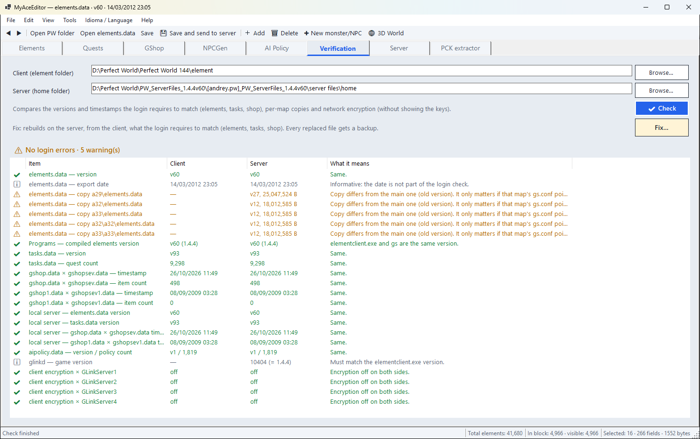
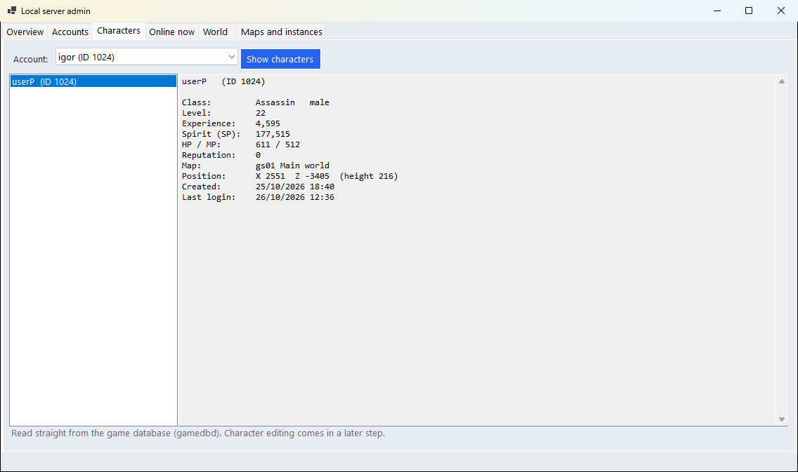
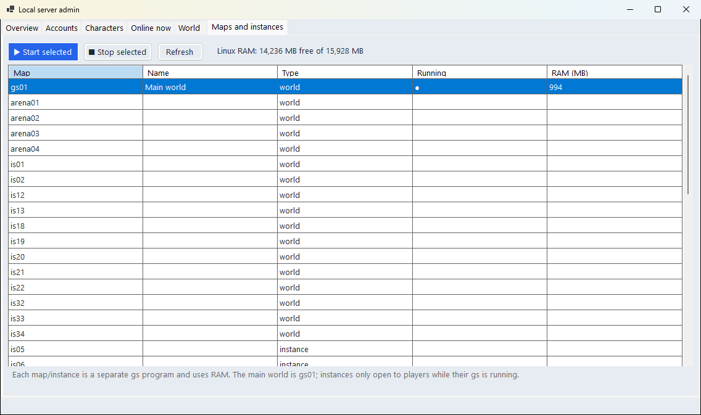
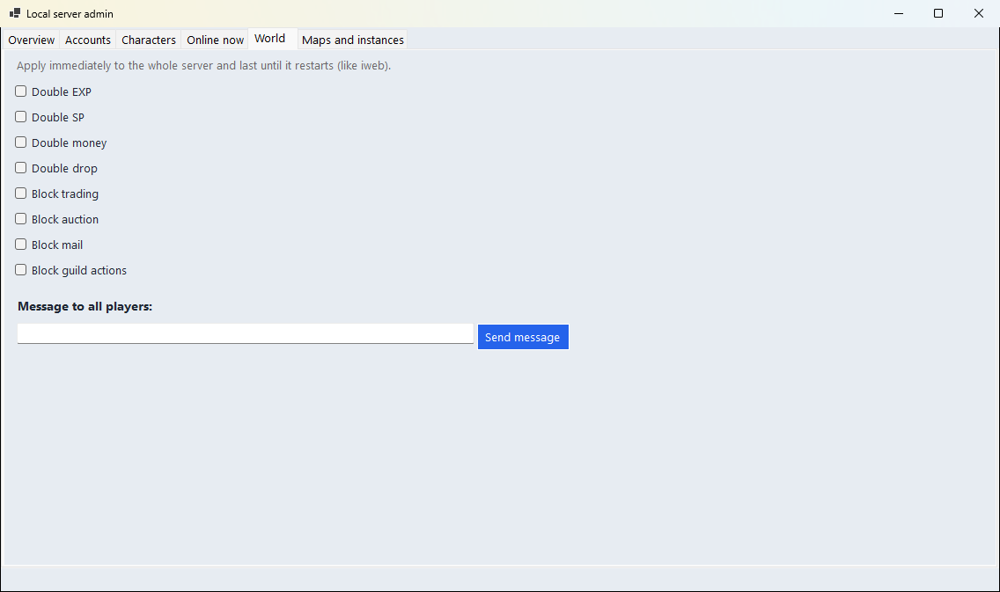
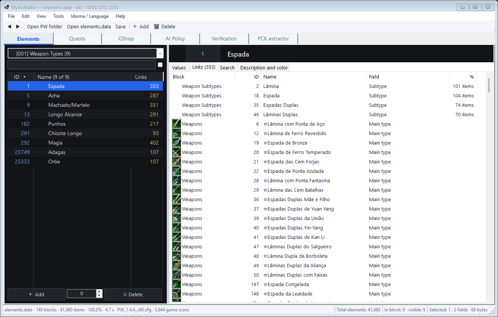
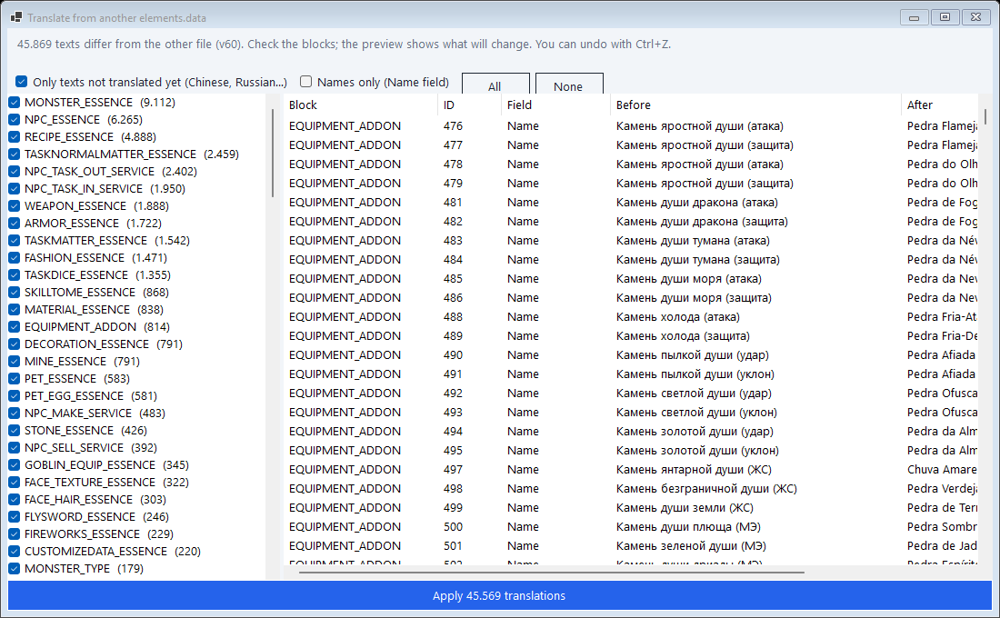
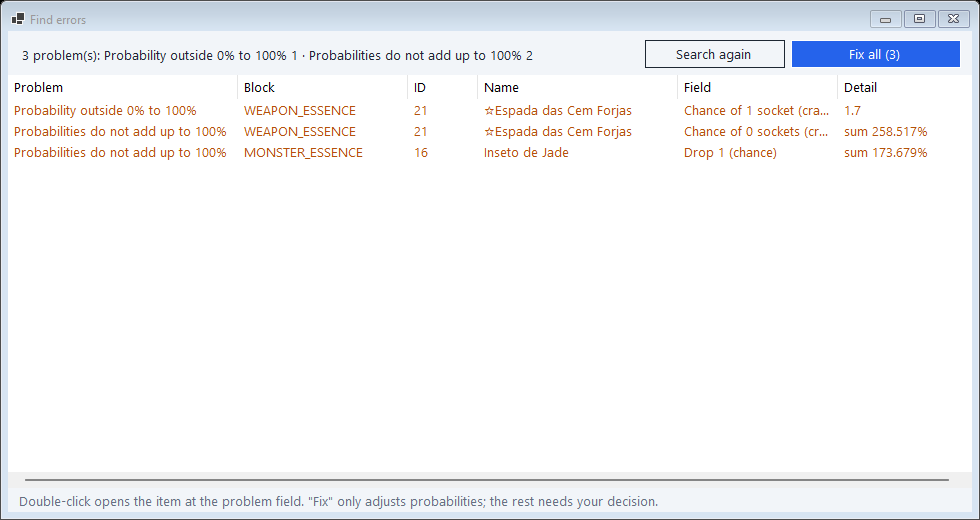
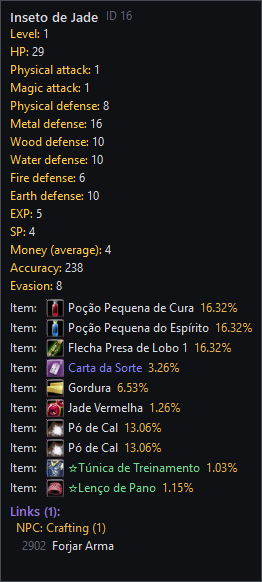

# MyAceEditor

<p align="center">
  <a href="README.md"></a>
  <a href="README.en.md"></a>
</p>

[](LICENSE)
[](CONTRIBUTING.md)

**Perfect World editing engine (Angelica engine)**: a native C#/WinForms desktop app (.NET 10) to read
and edit the game data, client and server, in a single window.
An **open, community project**: the goal is to make Perfect World 100% editable with a free tool.

**[⬇ Download the test version v0.2.0-beta (Windows)](https://github.com/ipasetto/MyAceEditor/releases/tag/v0.2.0-beta)** · [how to install, step by step](#how-to-install-step-by-step)


## What's new in v0.2.0-beta

**Updated on October 26, 2026.**

- **Test server on your PC**: the Server tab installs and controls a Perfect World server inside Windows (WSL); **Save and send to server** takes everything you edited and restarts it.
- **Server admin panel** (like iweb, but in a window): accounts (create, password, GM, **give CASH by ID**, ban), characters, who is online (kick, mute), double EXP/drop/money, broadcast to everyone, and every map or instance.
- **NPCGen**: where monsters, NPCs and gatherables spawn, with editable quantity, respawn, radius and monster, plus a **new monster/NPC** wizard based on a model.
- **3D World**: the game map in 3D (terrain, buildings, water and the monster and NPC models) to see and move spawn points.
- **Fuller check**: the version that `elementclient.exe` and `gs` require, what is on the local server, and the **`interfaces.pck` windows that crash the game**, with automatic fix.
- **`.pck` writing**: the interface editor saves straight into `interfaces.pck`, with backup, no sPCK needed.
- **Translate from another client** (Tools): texts, quests, NPC dialogs and packages from another client, only what fits your client's version.
- **Save all** (Ctrl+S) and auto-save; the shop refuses to save an item without a price (the server would not start).

## Features

### Elements (`elements.data`)
- Opens the Perfect World folder and **reloads it automatically** next time; reads and **writes** `elements.data` with byte-identical save verification and automatic backup.
- **Real game icons**, read straight from `surfaces.pck`; 3D thumbnails for monsters and NPCs without an icon.
- Layout in the style of the classic editors: blocks by category, type filter, search, sub-tabs per field group, names in the official game color.
- **Game-like tooltips**: stats, per-element defenses, immunities, drops with icon and chance, and who uses the item.
- **Links**: what each item uses and who uses it; **types and subtypes** list their subtypes and items (double-click filters the list).
- Codes explained right in the grid (combat type, aggressive, land/water/air, seconds per hit).
- **Undo/redo** (Ctrl+Z/Ctrl+Y) with action history.
- **Bulk change**: set, add, multiply, sequence, random and replace text, with a before/after preview.
- **Find errors** (Ctrl+E): IDs that don't exist, probabilities outside 0–100% or not adding up to 100%, duplicate IDs; probabilities fixed in one click.
- **Save as another version**: converts `elements.data` up or down (any version with a `.cfg`), matching blocks and fields by name.
- **Translate from another elements.data**: copies names and texts by ID from an already translated file, choosing the blocks and only what is still untranslated.

### Cash shop (GShop)
- **The same screen as the game**: drawn from `qshop.xml` in `interfaces.pck` and the textures in `surfaces.pck`, with the client's own fonts.
- Double-click a name, a price or a category to edit it right there; side panel for item, amount, picture, colored description, 4 sale options and gift.
- Saves `gshop.data` (client) and `gshopsev.data` (server) together with the same timestamp; undo/redo.

### Quests (`tasks.data` v93)
- Fields, texts, dialogs and subquests; **required/given items, monsters to kill and rewards** (gold, exp, SP, reputation, items) are editable.
- **Clone** a quest (new IDs, texts re-encoded) and **delete** a quest; quest names become links from NPCs.

### AI Policy (`aipolicy.data`)
- Policy and trigger tree with plain-language explanation, add/delete operations, **clone policy or trigger**, search and translation.

### NPCGen and 3D World
- **NPCGen** tab: every monster, NPC and gathering point of each map (`npcgen.data` read and written byte for byte); quantity, respawn, radius, trigger and who spawns there.
- **3D World**: terrain with the game textures, buildings, water, lighting and the monster/NPC models; go to a name or coordinate, drag points, create a new monster/NPC there, world map (M).

### Game interface and packages
- **Native PCK extractor** (no sPCK needed): image and text preview, extracts to `<pack>.files` like sPCK.
- **Interface editor** inside the extractor: the windows of `interfaces.pck` drawn like in the game; click, drag, resize and change text; **writes straight into the `.pck`** with backup.

### Test server
- **Server** tab: installs a 1.4.4 server in WSL (Windows' Linux), creates the account, starts and stops it; the original package files are never changed.
- **Save and send to server**: saves everything and sends elements, quests, shop, AI and the server configuration, rebuilding the server side from the client.
- **Admin panel**: accounts, CASH by ID (account or character), characters read from the game database, who is online, world attributes, broadcast, maps and instances with the memory each one uses.

### Client × server
- **Pair check**: points out what makes login fail with "wrong version" and **fixes** it by rebuilding the server side from the client, with backups.
- Checks the **compiled version** in `elementclient.exe` and `gs` (both refuse a different elements), the **local server** and the **windows the game looks for** in `interfaces.pck`.
- **Translate from another client**: the target client only receives the fields it has, even when the source is a newer version.
- **MCP** mode: the same operations available to AI agents.
- Interface in Portuguese, English and Simplified Chinese (`lang/*.json`).

### Gallery

Screenshots taken with a Brazilian client: game content (item, monster and quest names) is in Portuguese; the editor itself is in English.

| | |
|---|---|
|  |  |
| **3D World: monsters and NPCs on the game map** | **NPCGen: where each one spawns** |
|  |  |
| **Test server on your PC** | **Client × server check** |
|  |  |
| **Admin: characters** | **Admin: maps and instances** |
|  |  |
| **Admin: double EXP, locks and broadcast** | **Editable game windows, written into the .pck** |
|  |  |
| **Cash shop with the game screen** | **Quests** |
|  |  |
| **Weapon types: subtypes and items** | **Translate from another file** |
|  |  |
| **Find errors** | **Monster tooltip** |

## How to install (step by step)

Nothing else to install besides the program itself. Works on **Windows 10 or 11 (64-bit)**.

1. Open the **[Releases](https://github.com/ipasetto/MyAceEditor/releases)** page and, in the latest version, click the **`MyAceEditor-...-win-x64.zip`** file to download it (about 70 MB).
2. In your Downloads folder, **right-click** the `.zip` → **Extract All…** → **Extract**.
   Do not run the program from inside the `.zip`: it needs the `lang`, `PerfectWorld` and `Server` folders that come with it.
3. Open the extracted `MyAceEditor` folder and double-click **`MyAceEditor.exe`**.
4. If **"Windows protected your PC"** shows up: click **More info** → **Run anyway**.
   This happens because the program has no paid digital signature yet; the code is open and all here on GitHub.
5. In the program: **File → Open Perfect World folder…** and pick your game folder (the one with the `element` folder inside).
   Next time it opens the same folder by itself.

**Test server (optional)**: in the **Server** tab, pick the `server files` folder of a 1.4.4 package and click **Install / complete**.
If WSL is not on Windows yet, the program tells you: run `wsl --install --no-distribution` in a terminal as administrator and restart the PC once. Then just **Start** and join the game through the "Local" server.

**Tips**
- The program makes a **backup** before saving, but work on a **copy of the game folder** until you get used to it.
- To change the language: **Idioma / Language** menu.
- To update: download the new `.zip` and extract it over the old one (or into a new folder). Your preferences are kept in Windows.
- Found a bug? Open an [Issue](https://github.com/ipasetto/MyAceEditor/issues) with a screenshot.

> **Beta** versions are for testing: a lot already works, but there may still be bugs.

## Run from source (developers)

Requires Windows and the .NET 10 SDK.

```bash
dotnet run
```

Then **File → Open Perfect World folder…** and pick the folder that contains `element\`.

## Build the executable

```bash
dotnet publish -c Release -r win-x64 --self-contained -p:PublishSingleFile=true -p:PublishReadyToRun=true -o dist
```

Produces in `dist\` the `MyAceEditor.exe` (a single file that runs without installing anything) together with the `lang\`, `PerfectWorld\` and `Server\` folders and the `glfw3.dll` used by the 3D World. Ship the whole folder (see [CONTRIBUTING.md](CONTRIBUTING.md) to translate the interface).

## Status

| Area | Status |
|---|---|
| `elements.data`: read / write | ✅ ~98.6% / byte-identical with backup |
| Convert `elements.data` between versions | ✅ (common format; v191+ 🔜) |
| Native `.pck`/`.pkx` + icons + extractor | ✅ read; writing ✅ for `.pck` v2 (v3 and `.pkx` 🔜) |
| Field editors, links, bulk, undo, find errors, translator | ✅ |
| Quests (`tasks.data` v93) | ✅ fields, texts, lists and rewards; clone/delete (changing entry counts 🔜) |
| GShop (client + server) | ✅ with the game screen |
| AI Policy | ✅ read, operation editing, clone, search |
| Interface editor (`interfaces.pck`) | ✅ writes straight into the package |
| Client × server check and fix | ✅ includes program versions and `interfaces.pck` windows |
| NPCGen (where monsters, NPCs and mines spawn) | ✅ edit points, quantity, respawn and monster; Change ID updates it |
| 3D World | ✅ terrain, buildings, water, models; move and create points |
| Local test server (WSL) + admin panel | ✅ 1.4.4; panel actions still being tested in game |
| Start instances from the panel, edit characters, send items by mail | 🔜 |

Reference version tested: Perfect World 1.4.4 client/server (`elements.data` v60, `tasks.data` v93).
What's coming next is in the **[roadmap](docs/ROADMAP.md)**.

## Contributing

Contributions are very welcome! Read the **[contribution guide](CONTRIBUTING.md)** and pick a task
from the **[roadmap](docs/ROADMAP.md)** — the ones marked 🟢 are good first tasks. Docs are mostly in
Portuguese, but issues and pull requests in English are welcome.

## Documentation

| Document | What for |
|---|---|
| [docs/ARQUITETURA.md](docs/ARQUITETURA.md) | How the engine and Perfect World work: diagrams, layers, flow, formats |
| [docs/ROADMAP.md](docs/ROADMAP.md) | Future tasks organized in milestones |
| [docs/PARIDADE-RODY.md](docs/PARIDADE-RODY.md) | Feature-by-feature checklist against the classic editors |
| [docs/kb/PW-KB.md](docs/kb/PW-KB.md) | **Game** knowledge base: client, server, protocol, binary formats, versions |
| [docs/kb/ENGINE-KB.md](docs/kb/ENGINE-KB.md) | **Engine** knowledge base: what is implemented and how |
| [.claude/skills/pw-engine](.claude/skills/pw-engine/SKILL.md) | Claude Code skill that teaches the agent to use and maintain the KBs |

## License

[GNU General Public License v3.0](LICENSE). You may use, study, modify and distribute MyAceEditor;
modified versions that are distributed must also be open source under the GPL-3.0.

## Credits

Format knowledge comes from studying community tools and documentation
(sELedit, sTASKedit, sGSHOPedit, AIPolicyEditor, sNPCedit, sMAPtool, uPCK, UIEdit, Rody's Angelica Editor,
the mmorpg-devs.ru, RaGEZONE and PWDevGroup forums), listed in [PW-KB §R](docs/kb/PW-KB.md).
The code in this repository is original.

**Contributors:** LAOCHEN (RaGEZONE) — multi-version elements.data reader (170 .cfg, v6–v623),
MPPC decoder, progress/cancel window, regression tests and Simplified Chinese translation
(`lang/zh-CN.json`, docs in [docs/zh-CN](docs/zh-CN)). The full Chinese version is in the
`contrib/laochen-zh-CN` branch.

Perfect World is a trademark of Perfect World Co., Ltd. This project is not affiliated with it and does
not distribute game files.
