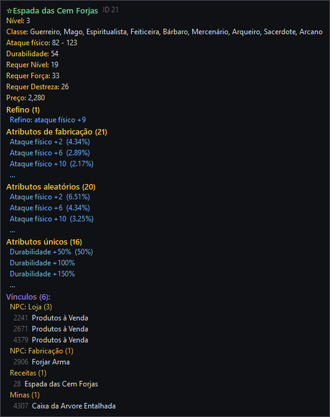

# MyAceEditor

<p align="center">
  <a href="README.md"></a>
  <a href="README.en.md"></a>
</p>

[](LICENSE)
[](CONTRIBUTING.md)

**Engine de edição do Perfect World (motor Angelica)**: aplicação desktop nativa em C#/WinForms
(.NET 10) para ler e editar os dados do jogo, cliente e servidor, numa única janela.
Projeto **aberto e comunitário**: a meta é tornar o Perfect World 100% editável com uma ferramenta livre.

**[⬇ Baixar a versão de teste (Windows)](https://github.com/ipasetto/MyAceEditor/releases)** · [como instalar, passo a passo](#como-instalar-passo-a-passo)


## Recursos

**Atualizado em 24/10/2026.**

### Elements (`elements.data`)
- Abre a pasta do Perfect World e **recarrega sozinho** na próxima vez; lê e **grava** o `elements.data` com prova de gravação idêntica e backup automático.
- **Ícones reais do jogo**, lidos direto do `surfaces.pck`.
- Tela no estilo dos editores clássicos: blocos por categoria, filtro por tipo, busca, sub-abas por grupo, nome na cor oficial do jogo.
- **Tooltip como no jogo**: atributos, defesas por elemento, imunidades, drops com ícone e chance, e quem usa o item.
- **Vínculos**: o que cada item usa e quem o usa; **tipos e subtipos** listam os subtipos e os itens deles (duplo clique filtra a lista).
- Códigos explicados na própria grade (tipo de combate, agressivo, terra/água/ar, segundos por golpe).
- **Desfazer/refazer** (Ctrl+Z/Ctrl+Y) com histórico de ações.
- **Alterar em lote**: definir, somar, multiplicar, sequência, aleatório e substituir texto, com prévia antes/depois.
- **Procurar erros** (Ctrl+E): IDs que não existem, probabilidades fora de 0–100% ou que não somam 100%, IDs repetidos; corrige as probabilidades com um clique.
- **Salvar em outra versão**: converte o `elements.data` para cima ou para baixo (qualquer versão com `.cfg`), casando blocos e campos pelo nome.
- **Traduzir com outro elements.data**: copia nomes e textos pelo ID de um arquivo já traduzido, escolhendo os blocos e só o que falta traduzir.

### Loja de cash (GShop)
- **A mesma tela do jogo**: desenhada com o `qshop.xml` do `interfaces.pck` e as texturas do `surfaces.pck`, com as fontes do próprio cliente.
- Duplo clique no nome, no preço ou numa categoria edita ali mesmo; painel ao lado para item, quantidade, figura, descrição colorida, 4 opções de venda e presente.
- Salva o `gshop.data` (cliente) e o `gshopsev.data` (servidor) juntos, com o mesmo timestamp; desfazer/refazer.

### Quests (`tasks.data` v93)
- Campos, textos, diálogos e subquests; **itens exigidos/dados, monstros a matar e prêmios** (ouro, exp, SP, reputação, itens) editáveis.
- **Clonar** quest (IDs novos, textos recodificados) e **excluir** quest; nome da quest vira link a partir dos NPCs.

### AI Policy (`aipolicy.data`)
- Árvore de políticas e triggers com explicação em português, adicionar/excluir operações, **clonar política ou trigger**, busca e tradução.

### Interface do jogo e pacotes
- **Extrator de PCK nativo** (sem sPCK): prévia de imagens e textos, extrai para `<pacote>.files` como o sPCK.
- **Editor de interfaces** dentro do extrator: as janelas do `interfaces.pck` desenhadas como no jogo; clicar, arrastar, redimensionar e mudar o texto (salva na pasta do sPCK).

### Cliente × servidor
- **Verificação do par**: aponta o que derruba o login com "versão errada" e **corrige** refazendo o lado do servidor a partir do cliente, com backup.
- Modo **MCP**: as mesmas operações disponíveis para agentes de IA.
- Interface em português, inglês e chinês simplificado (`lang/*.json`).

### Galeria

| | |
|---|---|
|  |  |
| **Loja de cash com a tela do jogo** | **Janelas do jogo editáveis** |
|  |  |
| **Tipos de arma: subtipos e itens** | **Quests** |
|  |  |
| **Traduzir com outro arquivo** | **Procurar erros** |
|  |  |
| **Tooltip de monstro** | **Tooltip de arma** |

## Como instalar (passo a passo)

Não precisa instalar nada além do próprio programa. Funciona no **Windows 10 ou 11 (64 bits)**.

1. Abra a página **[Releases](https://github.com/ipasetto/MyAceEditor/releases)** e, na versão mais recente, clique no arquivo **`MyAceEditor-...-win-x64.zip`** para baixar (cerca de 64 MB).
2. Na pasta Downloads, clique com o **botão direito** no `.zip` → **Extrair tudo…** → **Extrair**.
   Não abra o programa de dentro do `.zip`: ele precisa das pastas `lang` e `PerfectWorld` que vêm junto.
3. Entre na pasta extraída `MyAceEditor` e dê dois cliques em **`MyAceEditor.exe`**.
4. Se aparecer **"O Windows protegeu o computador"**: clique em **Mais informações** → **Executar assim mesmo**.
   Isso acontece porque o programa ainda não tem assinatura digital paga; o código é aberto e está todo aqui no GitHub.
5. No programa: **Arquivo → Abrir pasta do Perfect World…** e escolha a pasta do seu jogo (a que tem a pasta `element` dentro).
   Na próxima vez ele abre sozinho a mesma pasta.

**Dicas**
- O programa faz **cópia de segurança** antes de gravar, mas trabalhe numa **cópia da pasta do jogo** até se acostumar.
- Para trocar o idioma: menu **Idioma / Language**.
- Para atualizar: baixe o `.zip` novo e extraia por cima (ou numa pasta nova). Suas preferências ficam guardadas no Windows.
- Achou um erro? Abra uma [Issue](https://github.com/ipasetto/MyAceEditor/issues) com um print da tela.

> As versões **beta** são de teste: muita coisa já funciona, mas ainda pode haver erros.

## Rodar a partir do código (desenvolvedores)

Requer Windows e o SDK do .NET 10.

```bash
dotnet run
```

Depois, **Arquivo → Abrir pasta do Perfect World…** e escolha a pasta que contém `element\`.

## Gerar o executável

```bash
dotnet publish -c Release -r win-x64 --self-contained -p:PublishSingleFile=true -p:PublishReadyToRun=true -o dist
```

Gera `dist\MyAceEditor.exe`, um arquivo único que roda sem instalar nada. Copie também a pasta `lang\` para ao lado do `.exe` (ela traz os idiomas da interface; veja [CONTRIBUTING.md](CONTRIBUTING.md) para traduzir).

## Estado

| Área | Estado |
|---|---|
| `elements.data`: leitura / gravação | ✅ ~98,6% / byte-idêntica com backup |
| Converter `elements.data` entre versões | ✅ (formato comum; v191+ 🔜) |
| `.pck`/`.pkx` nativo + ícones + extrator | ✅ leitura (gravação 🔜) |
| Editores de campo, vínculos, lote, desfazer, procurar erros, tradutor | ✅ |
| Quests (`tasks.data` v93) | ✅ campos, textos, listas e prêmios; clonar/excluir (mudar quantidade de entradas 🔜) |
| GShop (cliente + servidor) | ✅ com a tela do jogo |
| AI Policy | ✅ leitura, edição de operações, clonar, busca |
| Editor de interfaces (`interfaces.pck`) | ✅ salva na pasta do sPCK (gravar `.pck` 🔜) |
| Verificação e correção do par cliente × servidor | ✅ |
| NPCGen, mapas, servidor de teste automático | 🔜 formatos documentados |

Versão de referência testada: cliente/servidor Perfect World 1.4.4 (`elements.data` v60, `tasks.data` v93).
O que vem pela frente está no **[roadmap](docs/ROADMAP.md)**.

## Contribuir

Contribuições são muito bem-vindas! Leia o **[guia de contribuição](CONTRIBUTING.md)** e escolha uma
tarefa no **[roadmap](docs/ROADMAP.md)** — as marcadas com 🟢 são boas para começar.

## Documentação

| Documento | Para quê |
|---|---|
| [docs/ARQUITETURA.md](docs/ARQUITETURA.md) | Como a engine e o Perfect World funcionam: diagramas, camadas, fluxo, formatos |
| [docs/ROADMAP.md](docs/ROADMAP.md) | Tarefas futuras organizadas em marcos |
| [docs/PARIDADE-RODY.md](docs/PARIDADE-RODY.md) | Checklist função por função em relação aos editores clássicos |
| [docs/kb/PW-KB.md](docs/kb/PW-KB.md) | Base de conhecimento do **jogo**: cliente, servidor, protocolo, formatos binários, versões |
| [docs/kb/ENGINE-KB.md](docs/kb/ENGINE-KB.md) | Base de conhecimento da **engine**: o que está implementado e como |
| [.claude/skills/pw-engine](.claude/skills/pw-engine/SKILL.md) | Skill do Claude Code que ensina o agente a usar e manter as KBs |

## Licença

[GNU General Public License v3.0](LICENSE). Você pode usar, estudar, modificar e distribuir o
MyAceEditor; versões modificadas que forem distribuídas também precisam ter o código aberto sob a GPL-3.0.

## Créditos

O conhecimento dos formatos vem do estudo de ferramentas e documentação da comunidade
(sELedit, sTASKedit, sGSHOPedit, AIPolicyEditor, sNPCedit, sMAPtool, uPCK, UIEdit, Rody's Angelica Editor,
fóruns mmorpg-devs.ru, RaGEZONE e PWDevGroup), listadas em [PW-KB §R](docs/kb/PW-KB.md).
O código deste repositório é original.

**Contribuidores:** LAOCHEN (RaGEZONE) — leitor multi-versão do elements.data (170 .cfg, v6–v623),
decodificador MPPC, janela de progresso/cancelamento, testes de regressão e tradução para chinês
simplificado (`lang/zh-CN.json`, documentação em [docs/zh-CN](docs/zh-CN)). A versão completa em chinês
está no branch `contrib/laochen-zh-CN`.

Perfect World é marca da Perfect World Co., Ltd. Este projeto não é afiliado a ela e não distribui
arquivos do jogo.
