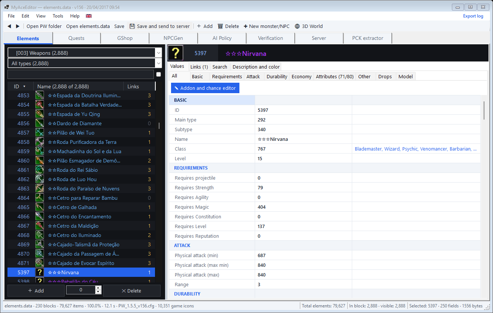
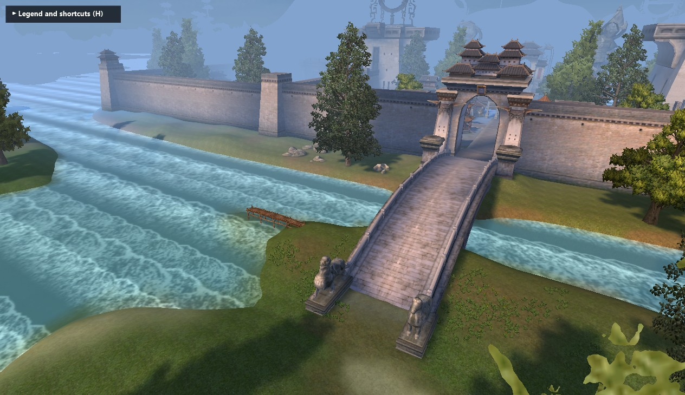
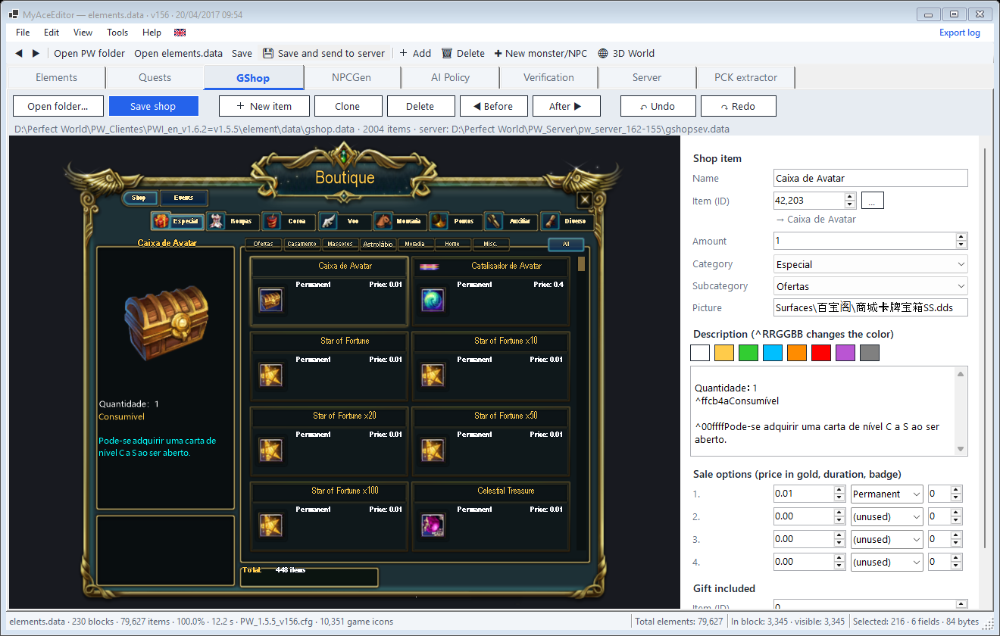
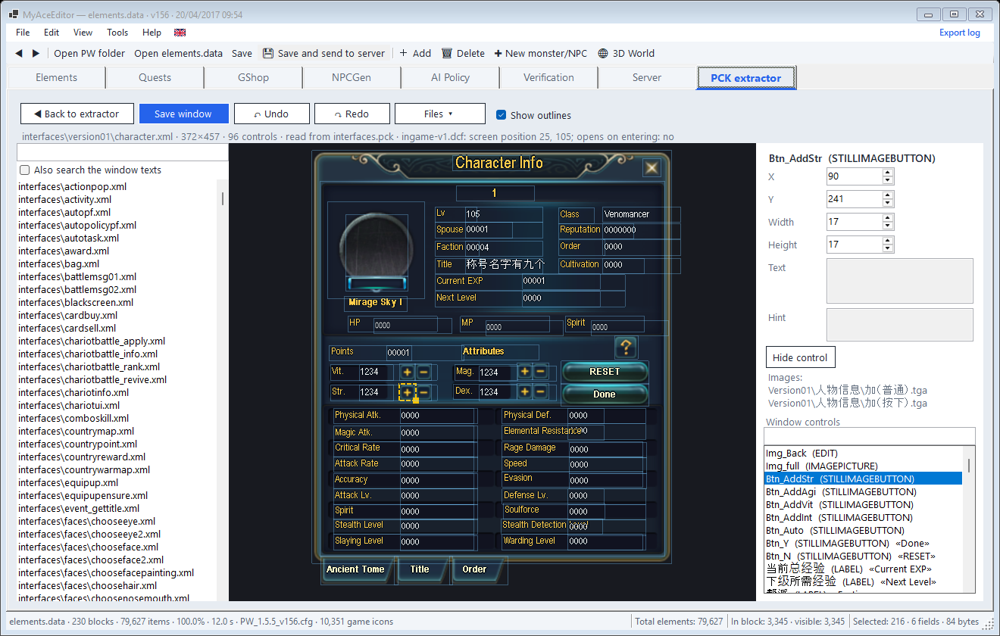
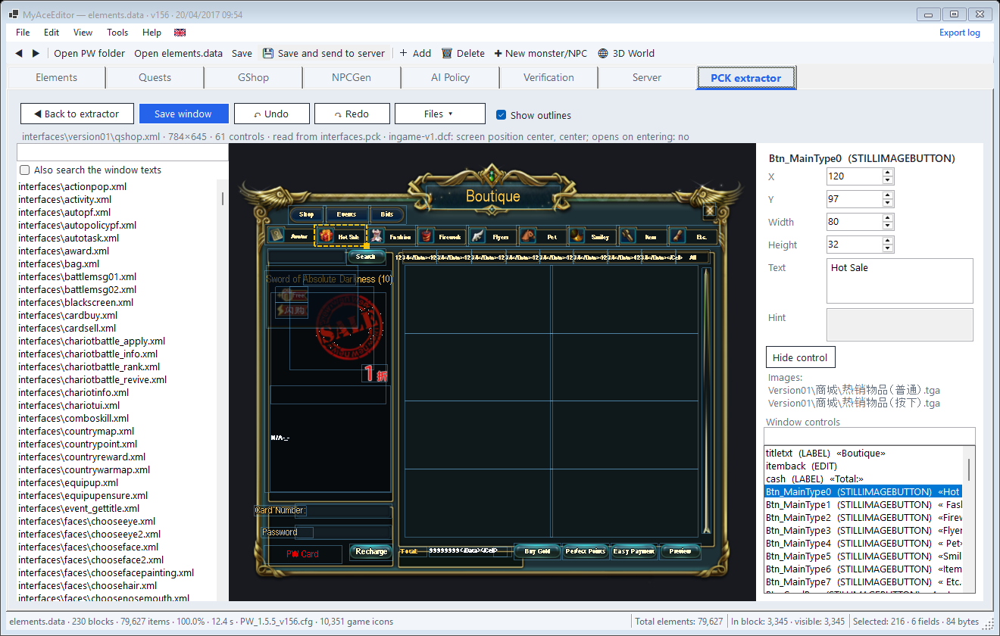
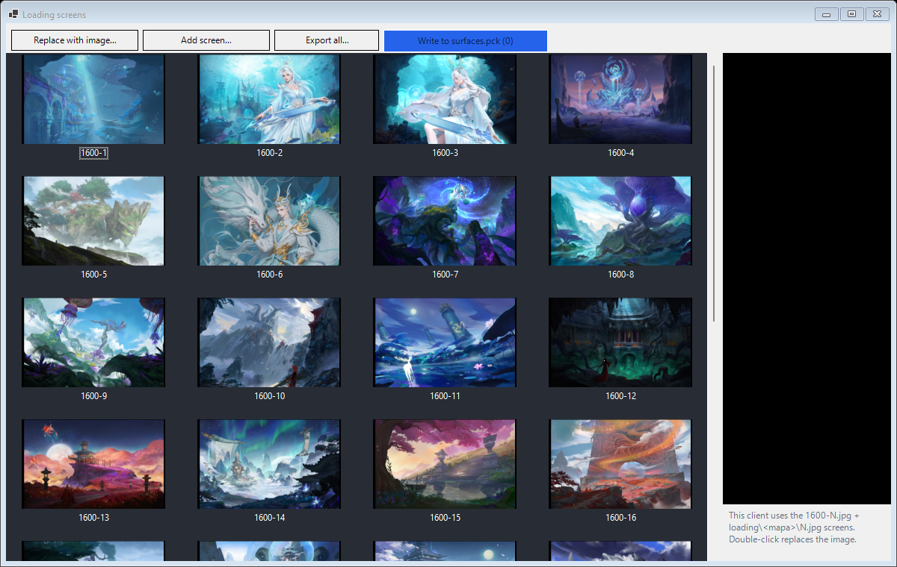
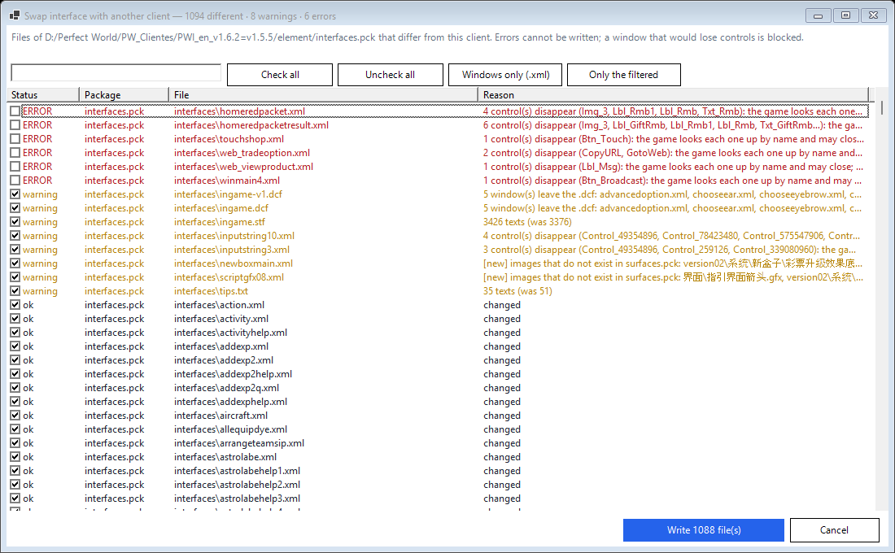
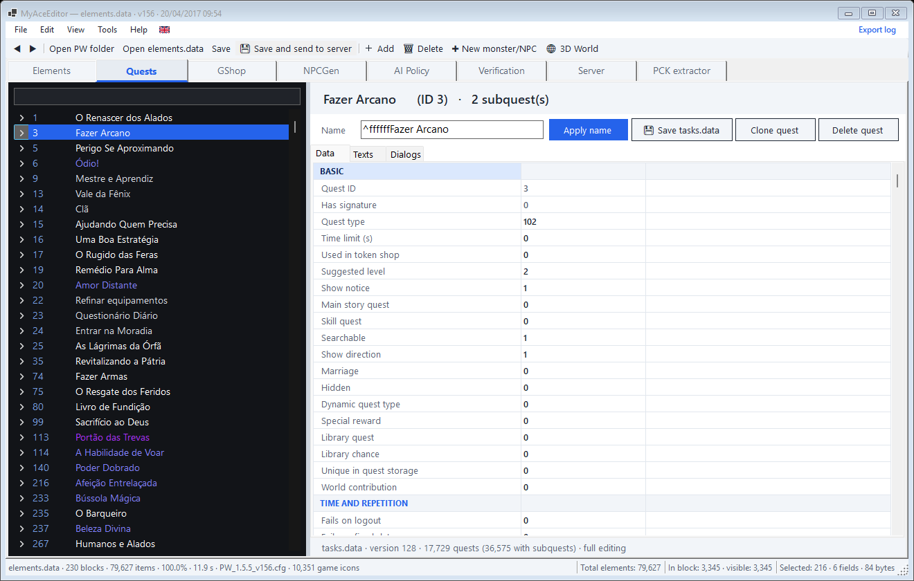
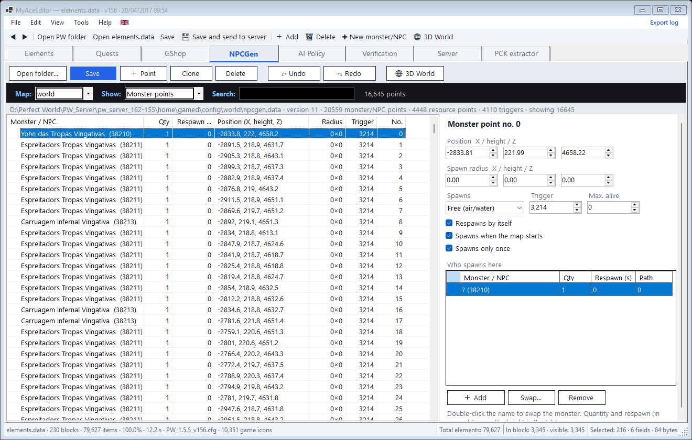
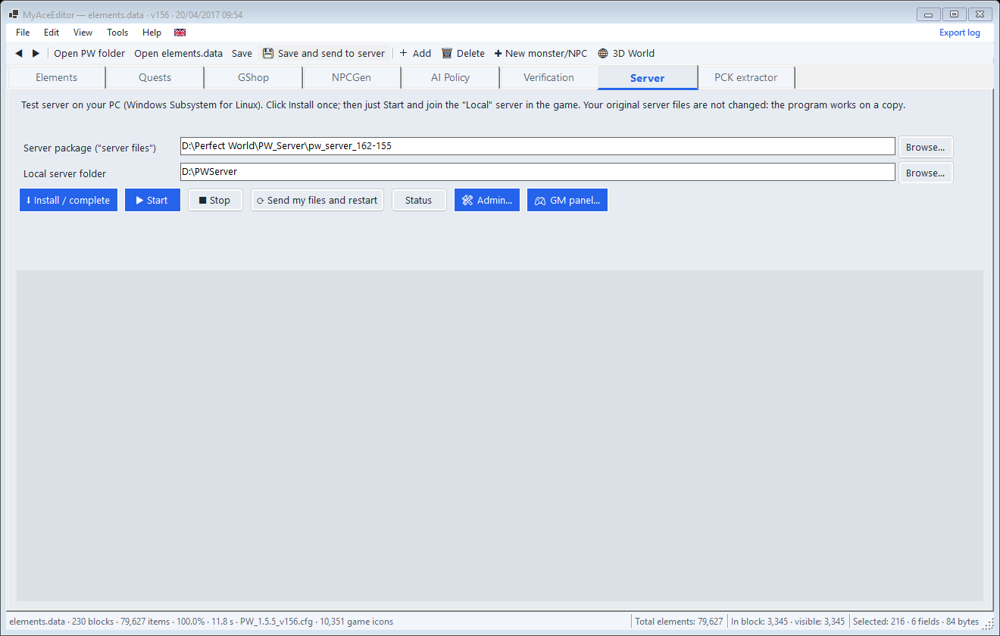

# MyAceEditor

[](LICENSE)
[](#install)
[](https://dotnet.microsoft.com/)
[](CONTRIBUTING.md)

**An open-source editor for Perfect World (Angelica engine) — client and server data in one native Windows app.**

MyAceEditor reads and writes the game files (`elements.data`, `tasks.data`, `gshop`, `aipolicy.data`, `npcgen.data`,
`.pck` packages and the interface), shows them the way the game shows them, checks that client and server still match,
and can run a local test server so you see your changes in game. Everything is saved with a backup and verified
byte by byte before it touches your files.

**[⬇ Download the latest release (Windows x64)](https://github.com/ipasetto/MyAceEditor/releases)** · [Install](#install) · [Features](#features) · [Screenshots](#screenshots) · [Contributing](#contributing)



---

## Features

### Game data
- **`elements.data`** — opens any version from v6 to v623 (170 layouts), saves byte-identical, real game icons and
  3D thumbnails, game-like tooltips, links ("uses" / "used by"), bulk edit, undo/redo, find errors, advanced search,
  convert between versions, Save-all (Ctrl+S) and auto-save.
- **Item rules from the server code** run before saving (unique IDs, shop limits, subtypes, fixed-ID configs), so an
  edited item does not crash the server or disappear in game ([game rules](docs/REGRAS-DO-JOGO.md)).
- **Quests (`tasks.data`)** — every version tested (v93, v128, v129, v187, v198): fields, texts, dialogs, rewards,
  clone/delete, and simple quests created right inside the 3D World.
- **GShop** — client `gshop.data` and server `gshopsev.data` edited together, on a copy of the in-game shop screen.
- **AI Policy** — triggers, conditions and operations with plain-language explanations, monster speech translation.
- **NPCGen** — where monsters, NPCs and resources spawn: quantity, respawn, radius, monster, new monster/NPC wizard.

### Interface (everything UI)
- **Interface editor** — game windows (`interfaces.pck`) drawn with the client's own fonts and textures. Move, resize,
  edit text and hints, hide controls safely, list every control, search text across all windows, and see which `.dcf`
  loads each window. Writes straight into the `.pck`.
- **Export / import** — export a package to a folder, edit it with any tool, import it back. Every file is checked first:
  UTF-8 is converted to the UTF-16 the game reads, broken XML is refused, a window that loses a control the game looks up
  is refused, image format must match its extension.
- **Swap interface with another client** — take the whole interface, or only some windows, from another client; the
  images those windows need come along, and anything that would crash the game is blocked.
- **Loading screens and login background** — replace or add loading screens for both families
  (`载入1024/1280/16-9-N.jpg` on 1.4.4–1.5.5, `1600-N.jpg` plus per-map screens on 1.7.x); any image format and size is
  fitted automatically.

### Translation
- **Translate from another client** — quest texts, NPC speech, item texts, interface tables, window texts and hints,
  matched by ID or by window and control name, in any version. Only what your client has is touched, and text with
  different `%d`/`%s` markers is skipped.
- **Translate with another `elements.data`**, with a review window before saving.
- The app itself speaks **English, Português, Русский and 简体中文**.

### Server and checks
- **Verification** — the versions that `elementclient.exe` and `gs` expect, the client × server pair, and the
  `interfaces.pck` windows that crash the client, with one-click fixes.
- **Local test server** (WSL) — install, start, and *Save and send to server* to see changes in game.
- **Admin panel** — accounts, characters, who is online, broadcast, double EXP/drop, give cash, every map and instance.
- **3D World** — terrain, buildings, trees, grass, water and models of the real map; move, copy and create spawn points.
- **`.pck` extractor and writer** — native, no external tools; every write keeps a backup and is swapped in atomically.

## Screenshots

| | |
|---|---|
|  **3D World** — the real map: terrain, water, buildings and trees |  **GShop** — the in-game shop screen, client and server together |
|  **Interface editor** — game windows drawn with the client's fonts and textures |  **Every control listed**, with text, hint and hide |
|  **Loading screens** — replace or add, any image size |  **Swap / import** — every file checked before writing |
|  **Quests** — every field, text and dialog |  **NPCGen** — spawn points with names and quantities |
|  **Local test server** — install, start, send your files | |

## Tested versions

| Client | Notes |
|---|---|
| Perfect World 1.4.4 (BR "144", `elements.data` v60, `tasks.data` v93) | reference version, local server included |
| Perfect World 1.5.5 (BR "155", PWI 1.6.2 = v1.5.5) | |
| Perfect World 1.7.x (Maori "172", BR "180") | `.pck` v3, new loading screens and login scene |

Other versions open through the multi-version reader; if something does not look right, please open an issue.

## Safety

- **Byte-identical round trip**: a format is only editable after reading and writing it back produces the same bytes.
- **Backups** of every file and package before it changes (kept in `%LOCALAPPDATA%\MyAceEditor\backups`, last 5 of each).
- **Atomic writes**: the new file is written beside the old one, verified, then swapped in.
- **Game rules** checked on save; the game must be closed while packages are written.
- Still: work on a **copy of your game folder** until you get used to the tool.

## Install

Windows 10 or 11, 64-bit. Nothing else to install.

1. Download `MyAceEditor-...-win-x64.zip` from **[Releases](https://github.com/ipasetto/MyAceEditor/releases)**.
2. Right-click the `.zip` → **Extract All…** (do not run it from inside the zip: it needs the `lang`, `PerfectWorld` and `Server` folders).
3. Run **`MyAceEditor.exe`**. If *"Windows protected your PC"* appears: **More info → Run anyway** (the app is not signed yet; the code is all here).
4. **File → Open Perfect World folder…** and pick the folder that contains `element`. Next time it opens by itself.

**Local test server (optional):** in the **Server** tab pick a 1.4.4 server package and click **Install / complete**.
If WSL is missing, run `wsl --install --no-distribution` as administrator and restart once.

## Build from source

Requires Windows and the .NET 10 SDK.

```bash
dotnet run
```

```bash
dotnet publish -c Release -r win-x64 --self-contained -p:PublishSingleFile=true -p:PublishReadyToRun=true -o dist
```

`dist\` gets `MyAceEditor.exe` plus the `lang\`, `PerfectWorld\` and `Server\` folders and `glfw3.dll` (3D World); ship the whole folder.

## Status

| Area | Status |
|---|---|
| `elements.data` read / write | ✅ v6–v623; ~1.4% tail of Territory War data still kept as raw bytes |
| Quests | ✅ all fields and texts; full quest creation for more quest types 🔜 |
| GShop, NPCGen, AI Policy | ✅ (AI Policy: condition editing 🔜) |
| Interface: editor, import/export, swap, loading screens | ✅ (add/copy controls, multi-select align 🔜) |
| `.pck` | ✅ read v2/v3 + `.pkx`, write v2/v3 (`.pkx` writing 🔜) |
| Verification, local server, admin panel, 3D World | ✅ |
| Map editor, skills editor, starting races/classes | 🔜 see the [roadmap](docs/ROADMAP.md) |

## Contributing

Contributions are welcome — code, translations, tests on other game versions, bug reports with screenshots.
Read the **[contribution guide](CONTRIBUTING.md)** and pick a task from the **[roadmap](docs/ROADMAP.md)** or the
**[issues](https://github.com/ipasetto/MyAceEditor/issues)**. Internal docs are mostly in Portuguese; issues and pull
requests in English are fine.

| Document | What for |
|---|---|
| [docs/ARQUITETURA.md](docs/ARQUITETURA.md) | how the engine and the game fit together (diagrams) |
| [docs/kb/PW-KB.md](docs/kb/PW-KB.md) | game knowledge base: formats, protocol, versions, interface |
| [docs/kb/ENGINE-KB.md](docs/kb/ENGINE-KB.md) | what is implemented and where |
| [docs/REGRAS-DO-JOGO.md](docs/REGRAS-DO-JOGO.md) | server/client rules the editor enforces |
| [docs/ROADMAP.md](docs/ROADMAP.md) | upcoming work |

## License

[GNU General Public License v3.0](LICENSE). You may use, study, modify and share MyAceEditor; distributed modified
versions must stay open source under the GPL-3.0.

## Credits

Format knowledge comes from studying community tools and documentation — sELedit, sTASKedit, sGSHOPedit,
AIPolicyEditor, sNPCedit, sMAPtool, uPCK, UIEdit / Perfect Interface Editor, the official AUIEditor, Rody's Angelica
Editor and the RaGEZONE, mmorpg-devs.ru and PWDevGroup communities (sources in [PW-KB §R](docs/kb/PW-KB.md)).
The code in this repository is original.

**Contributors:** LAOCHEN (RaGEZONE) — multi-version `elements.data` reader (170 layouts, v6–v623), MPPC decoder,
progress window, regression tests and the Simplified Chinese translation ([docs/zh-CN](docs/zh-CN)).

Perfect World is a trademark of Perfect World Co., Ltd. This project is not affiliated with it and does not distribute
game files.
