# MyAceEditor

[](LICENSE)
[](#install)
[](#game-version)
[](https://dotnet.microsoft.com/)
[](CONTRIBUTING.md)

**A map editor and game-data editor for Perfect World (Angelica engine), in one native Windows app.**
Walk the real game world in 3D, move buildings, plant trees, paint the ground, dig lakes, paint shadows, place
monsters and write quests — then save, and the client *and* the server files are rewritten together, checked and
backed up.

**[⬇ Download v1.0](https://github.com/ipasetto/MyAceEditor/releases/latest)** (one `.exe`, nothing to install) ·
[Step by step](#from-an-empty-field-to-a-merchant-camp) · [3D World](#-the-3d-world-editor) · [Game data](#-game-data) ·
[Interface](#-interface) · [Translation](#-translation) · [Server & GM](#-server--gm) · [Safety](#-safety) ·
[Install](#install) · [Developer docs](docs/dev/README.md)

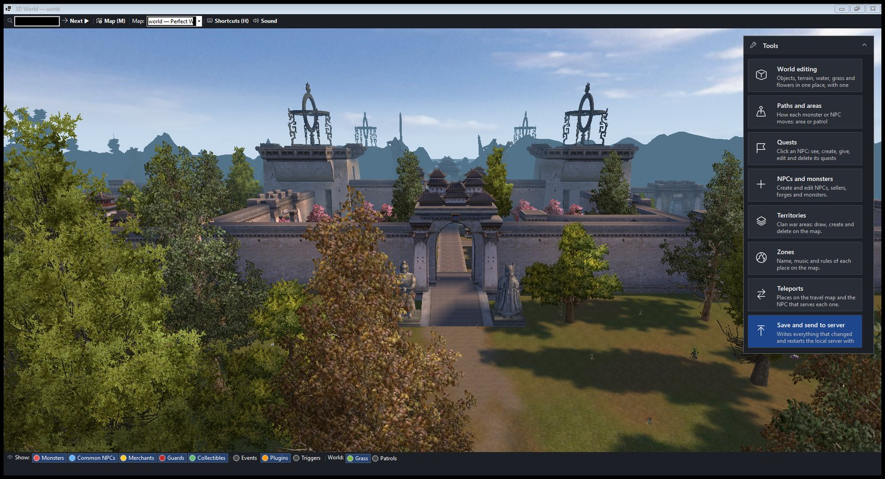

---

## What is inside

| | Area | What you do there |
|---|---|---|
| 🟩 |  | Edit the map itself: objects, terrain, water, grass, shadow and light, monsters, quests, zones, teleports, territories |
| 🟦 |  | `elements.data`, quests, the shop, AI policies, spawn points |
| 🟪 |  | Game windows, loading screens, swapping interfaces between clients |
| 🟧 |  | Translate a client from another client, any version |
| 🟥 |  | Version checks, a local test server, admin and GM panels |
| ⬜ |  | Backups, atomic writes, game rules checked before every save |

<a id="game-version"></a>
> **Game version.** MyAceEditor is built and tested on **Perfect World 1.5.5** (client PWI 1.6.2 = v1.5.5 and the
> 1.5.5 server). We chose to follow one version that the community knows well, because it saves a lot of time and
> keeps the code simple. Other versions often open too — the `elements.data` reader knows 170 layouts, v6 to v623 —
> but they are **not guaranteed to work 100%**. If you use another version, work on a copy of your files and please
> report what you find.

---

## 🟩 The 3D World editor


Open **3D World** from the toolbar and you are standing in the real map: terrain, water, buildings, trees, grass,
monsters, NPCs, sky, fog and day/night, read straight from the client and the server. Fly with **W A S D**, look
with the mouse, **Shift** to go faster. The tools live in a floating menu on the right; each one opens in its place
with a back arrow, and **Esc** always takes you back (asking first if something is not saved).

Things every tool does the same way:

- **Ctrl+Z / Ctrl+Y** on every action. In World editing the order is kept across tabs: the last thing you did is the
  first thing undone, whether it was a building, a brush stroke or a water edit.
- **Nothing is written until you click Save.** Then you get a summary of what will be written and a window that
  confirms what was saved.
- **The same keys for the same jobs:** **B** brush, **E** eraser, **I** eyedropper, in every tool that has them.
- **One backup per session:** everything you save while the 3D World is open goes into one item of *Restore backup*,
  which puts the map back exactly as it was when you opened it.

### From an empty field to a merchant camp

A real session, outside the west gate of the Dragon City, start to finish — every picture is the editor itself.

| | |
|---|---|
| 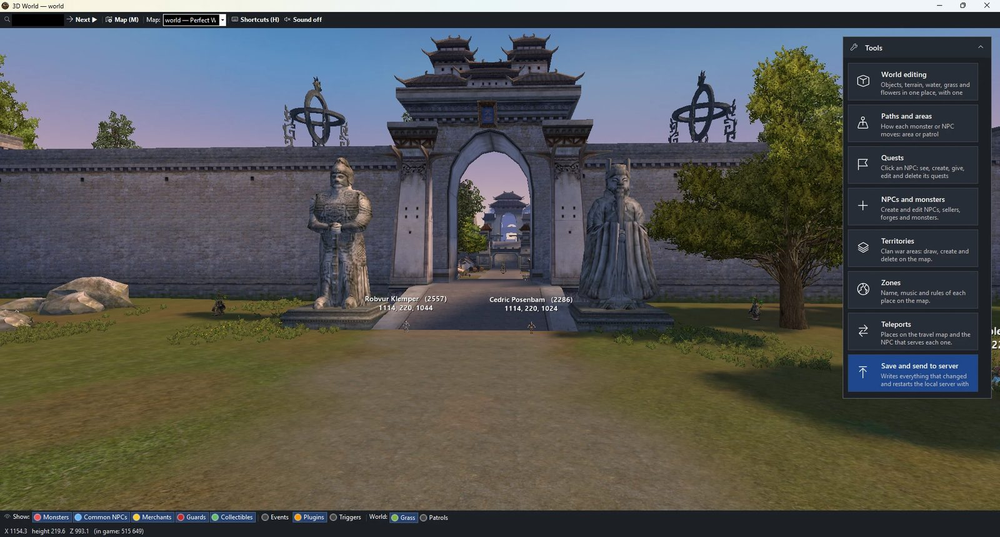 | **1. Pick the spot.** Fly to the place and open the tools menu: World editing, paths, quests, NPCs, territories, zones, teleports. |
| 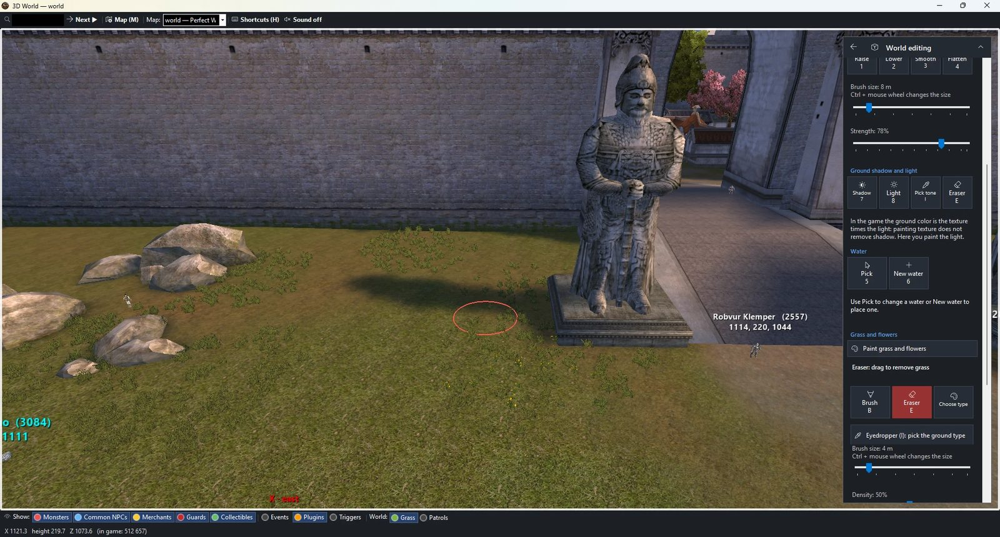 | **2. Clear the ground.** In *World editing → Terrain*, the grass **Eraser (E)** takes the grass off where the camp will stand. |
| 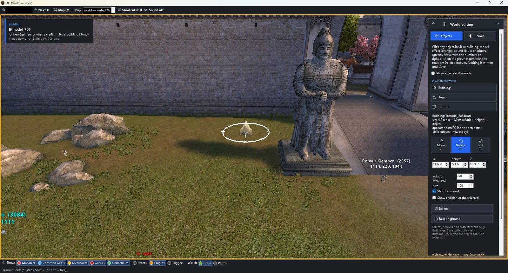 | **3. Bring a tent.** *Objects → Buildings* inserts any building of the client; turn it with the ring (**R**)… |
| 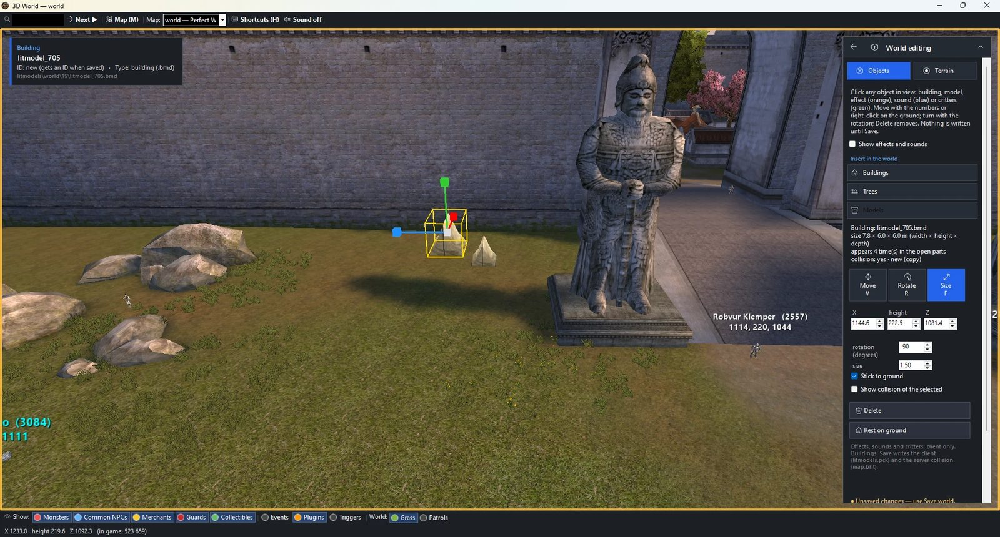 | **4. …and size it** with **F** (the box shows the new size live). Copy it with **Ctrl+C / Ctrl+V** for a second tent. |
| 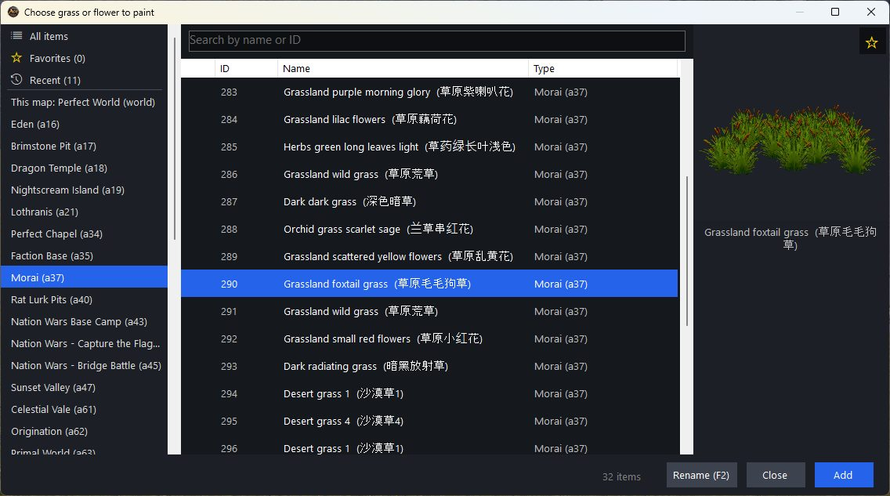 | **5. Choose plants** from the grass and flowers of every map, with a preview and favourites. |
| 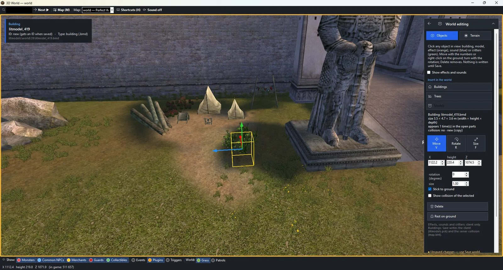 | **6. Dress the camp:** logs, a cart, a fire, bushes — each one placed, moved with the arrows and stuck to the ground. |
| 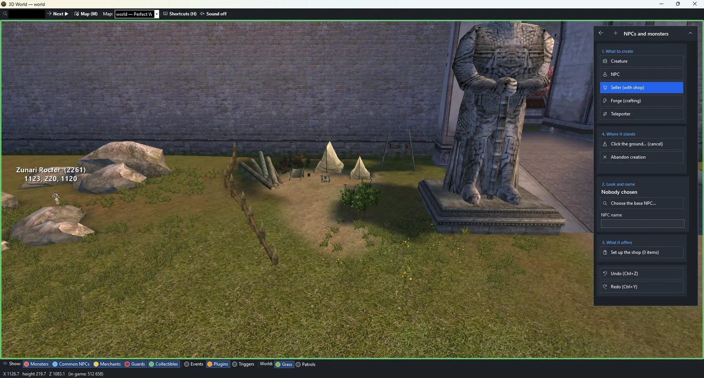 | **7. Create the merchant.** *NPCs and monsters → Seller (with shop)*: pick the base NPC, give it a name, click the ground. |
| 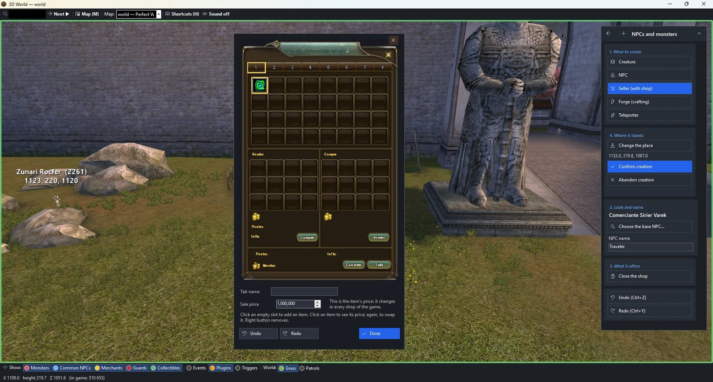 | **8. Fill the shop** in the same window the game uses: click an empty slot to add an item… |
| 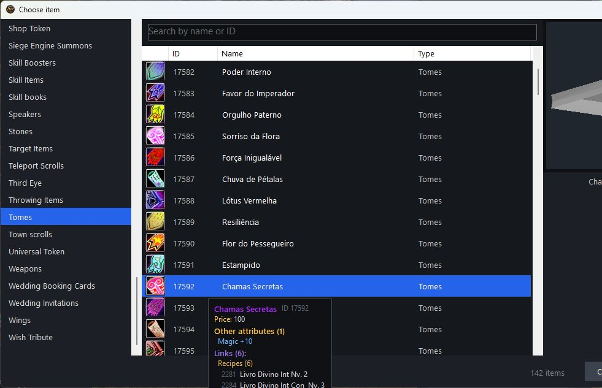 | **9. …chosen from the game's own items**, with icons, tooltips and links. |
| 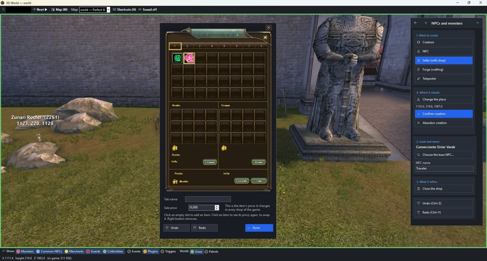 | **10. Set the price** and add more items; **Ctrl+Z** works here too. |
| 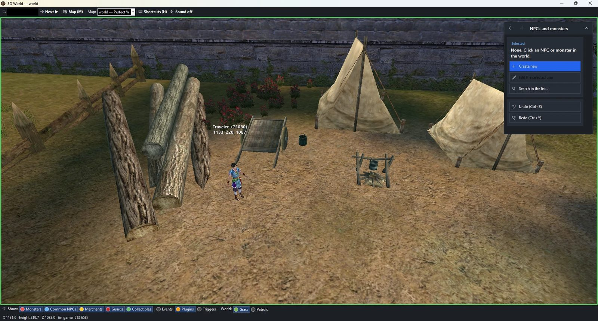 | **11. Confirm** — the merchant stands in the camp. |
| 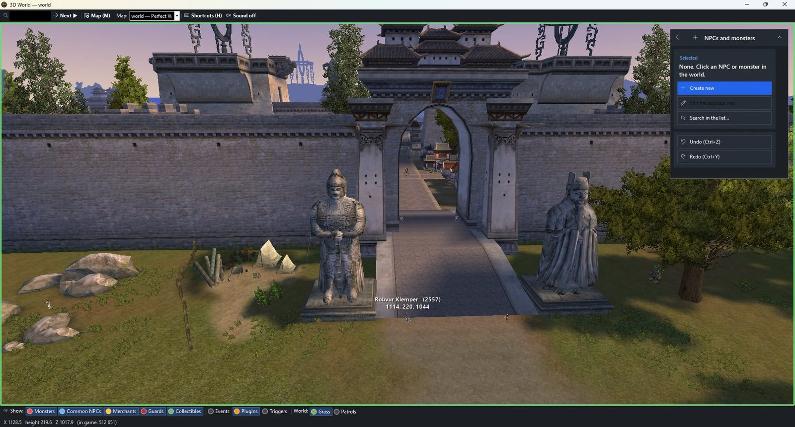 | **12. Save and send to the server.** The client and the server are written together; monsters walk around the new tents. |

### World editing — Objects

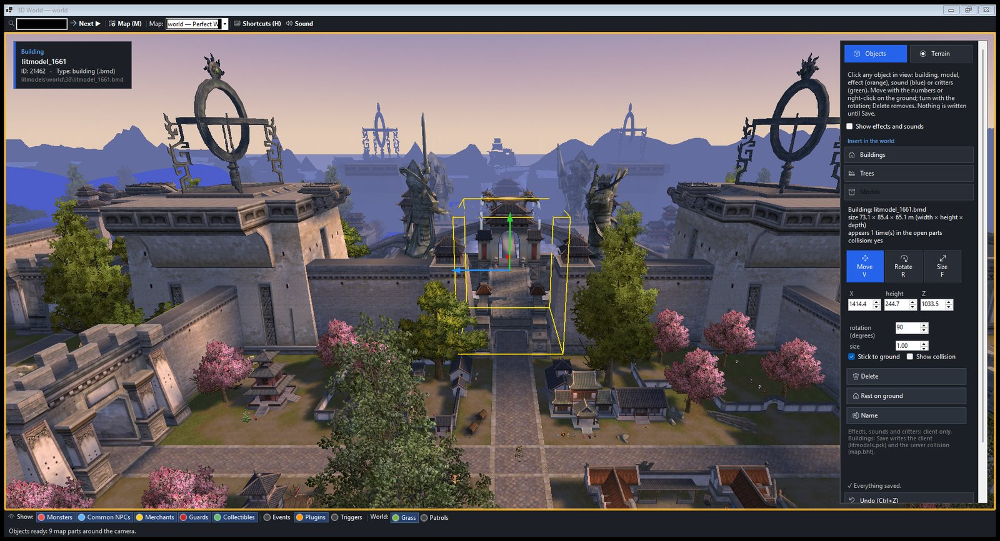

Click anything you see: a building, a model, a tree, an effect, a sound or a group of critters.

- **Move (V), Rotate (R), Size (F)** with arrows in the world or by typing numbers; *Stick to ground* and
  *Rest on ground* keep things on the terrain.
- **Copy and paste** (Ctrl+C / Ctrl+V) — a ghost follows the mouse, one object per click. **Delete** removes.
- **Insert buildings** from a catalogue of every map and instance of your client, with a 3D preview, favourites
  and recent items; **plant trees** of any type from any map.
- The **info card** (top left) shows what is selected: name, ID, type and file.
- **Give buildings a name** — names are shown in the catalogue and kept for you.

- **Show collision** draws, in red, the solid parts of the selected building (where the player bumps).

When you save, the server is updated too: the building collision (`map.bht`), the paths monsters can walk
(`.rmap`, including bridges and floors in `.dhmap`), the flight space of flying monsters (`.octr`) and the ground
around every tree. Monster paths follow the **mesh** of the objects you place: walls and rails block them, bridge
decks become floors they walk on, and a tree blocks its trunk and roots. Copied objects behave like the originals
in game.

### World editing — Terrain

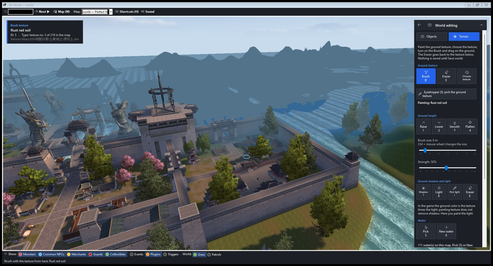

| Section | Keys | What it does |
|---|---|---|
| Ground texture | **B** brush · **E** eraser · **I** eyedropper | Paint any texture of the map — or take one from another map; the eraser goes back to the texture underneath |
| Ground height | **1** raise · **2** lower · **3** smooth · **4** flatten | Sculpt the terrain; the server height map and the monster paths are rebuilt when you save |
| Shadow and light | **7** shadow · **8** light · **I** pick tone · **E** eraser | Paint the light map of the ground, day and night together; the eyedropper picks a shadow or a lit tone (see below) |
| Water | **5** pick · **6** new water | Lakes and rivers: level, size, colour, copy/paste, delete; client and server water written together |
| Grass and flowers | **B** brush · **E** eraser · **I** eyedropper | Paint grass and flowers of any type from any map, with size and density |

**Ctrl + mouse wheel** changes the brush size. Brush size and strength are remembered between sessions.

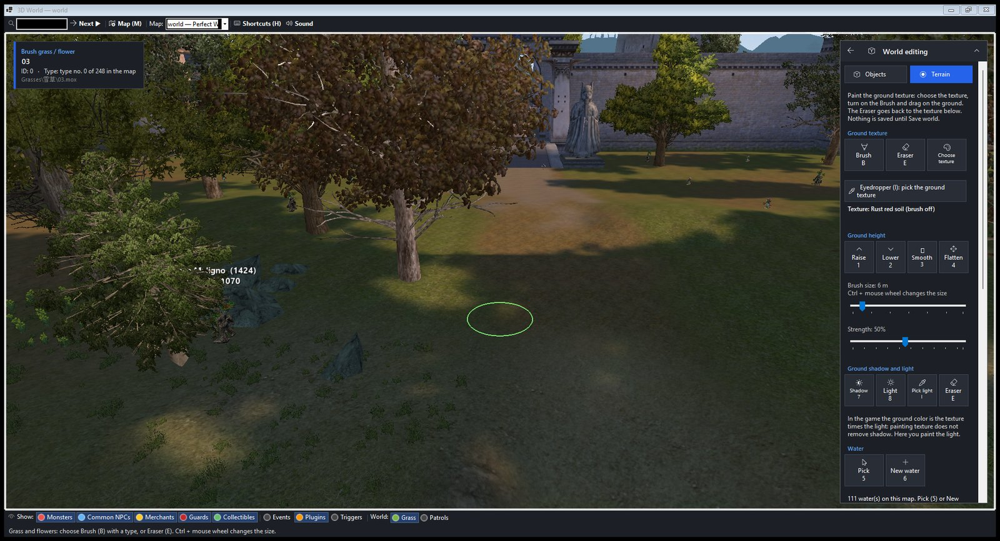

**Shadow and light.** In Perfect World the colour of the ground is *texture × light map*, so painting a texture never
removes a shadow. The shadow brush paints the light map itself; *Pick light* copies the light of one spot so a
shadow can be matched to the ground around it. Only the 4 × 4 m blocks you touched are rewritten — the rest of the
file stays byte-for-byte the same.

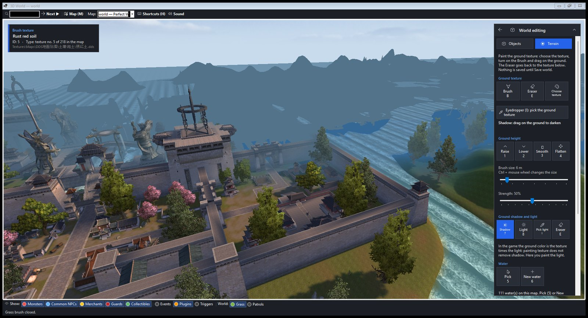

### Paths and areas

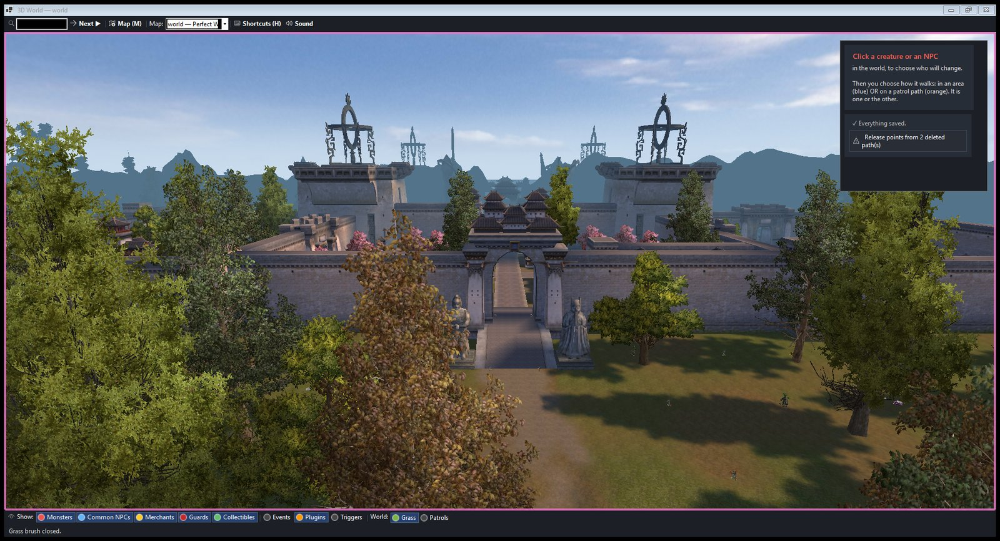

How every monster or NPC moves: a wandering area or a patrol path. Patrol points are circles with X/Y/Z arrows;
**Space** marks a new point and links it to the last one.

### Quests

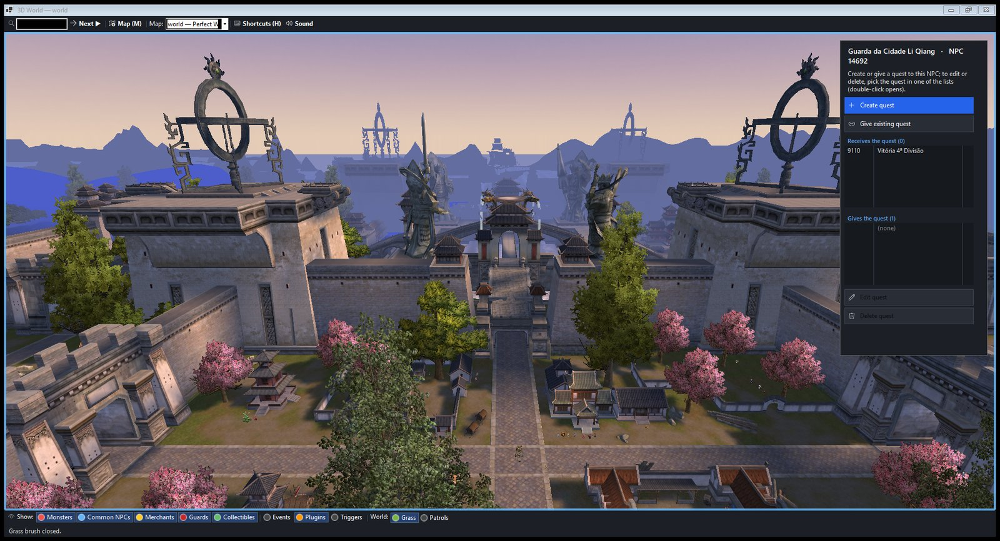

Click an NPC to see the quests it gives and receives, and create, give, edit or delete them right there. Simple
quests — talk, go to a place, kill, obtain, deliver, wait — are made in a few steps; rewards and requirements are
chosen from the item list, and the quest rules from the server code are checked before saving.

### NPCs and monsters

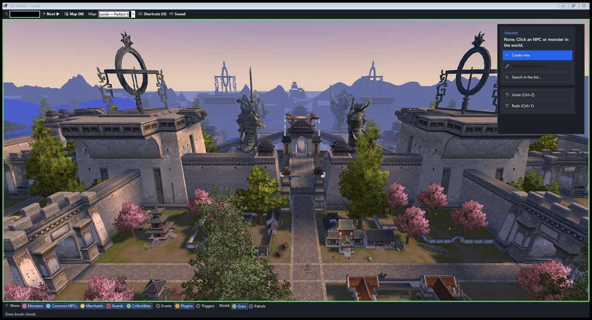

Create and edit NPCs, sellers, forges and monsters, place them in the world and set their drops. Click any creature or
NPC: its panel opens at the bottom with **Move (V)** and **Rotate (R)** — arrows or a ring on the creature, live, one
Ctrl+Z step per drag.

### Teleports

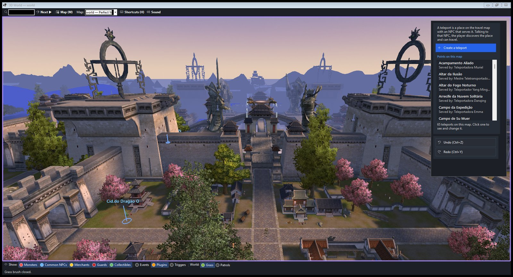

The places of the travel map and the NPC that serves each one: add a destination, set the price, place the NPC.

### Zones

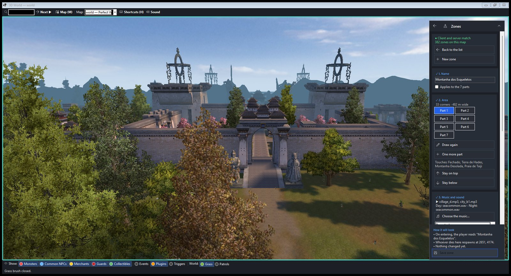

Name, music, ambient sound and rules of every place of the map (`precinct.clt`), drawn on the map.

### Territories

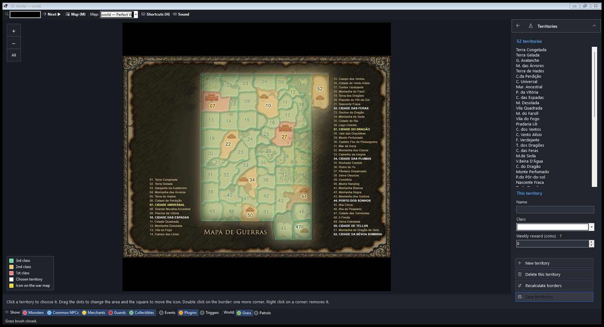

The clan war map (`domain.data` and `domain.sev`): draw, create and delete territories.

### Save and send to server

Writes everything that changed and restarts the local test server with it, so you can log in and see your work.

---

## 🟦 Game data


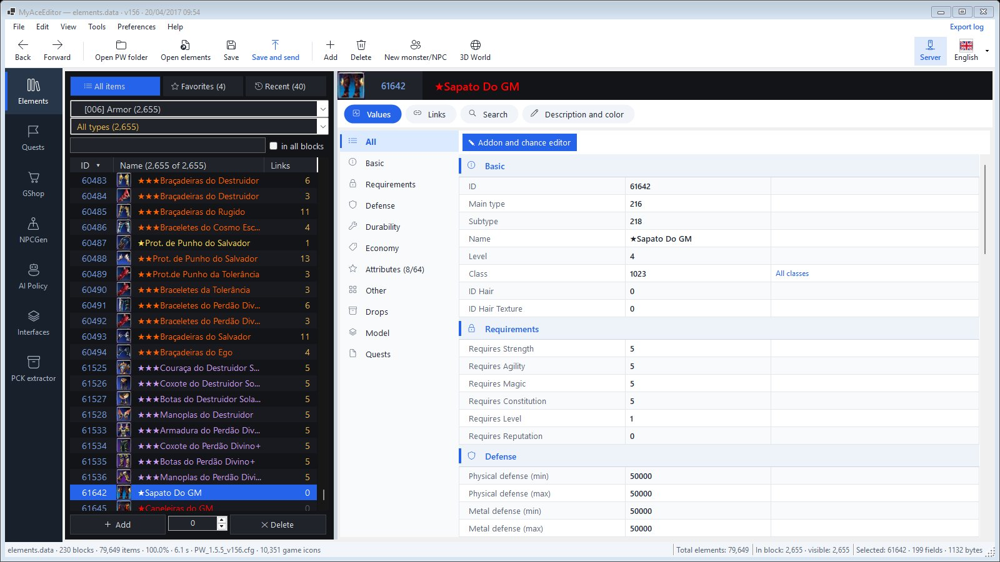

- **`elements.data`** — every field of every item, monster, NPC and skill-related record; real game icons and 3D
  thumbnails, game-like tooltips, links (*uses* / *used by*), bulk edit, advanced search, find errors, convert between
  versions, undo/redo and Save-all (**Ctrl+S**). Saves byte-identical.
- **Item rules from the server code** run before saving (unique IDs, shop limits, subtypes, fixed-ID configs), so an
  edited item does not crash the server or vanish in game ([game rules](docs/REGRAS-DO-JOGO.md)).

| Quests (`tasks.data`) | GShop |
|---|---|
| 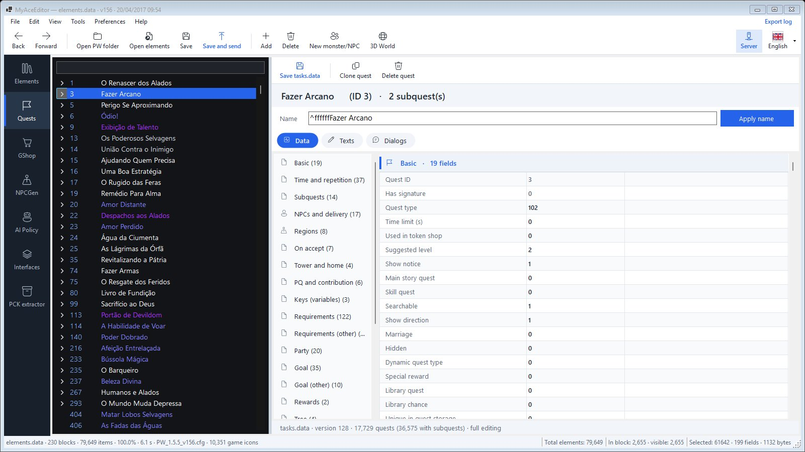 | 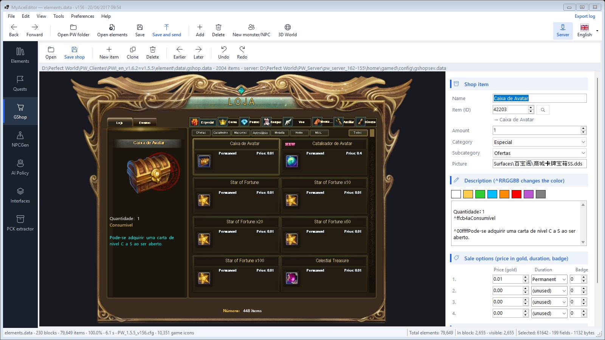 |
| Every field, text and dialog; clone and delete; quests created in the 3D World appear here | Client `gshop.data` and server `gshopsev.data` edited together, on a copy of the in-game shop |

| AI Policy | NPCGen |
|---|---|
| 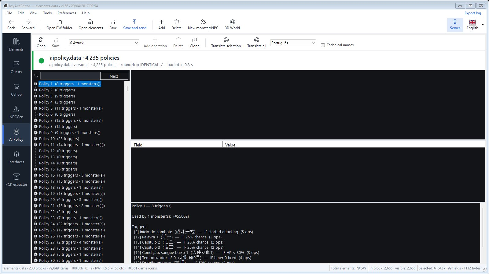 | 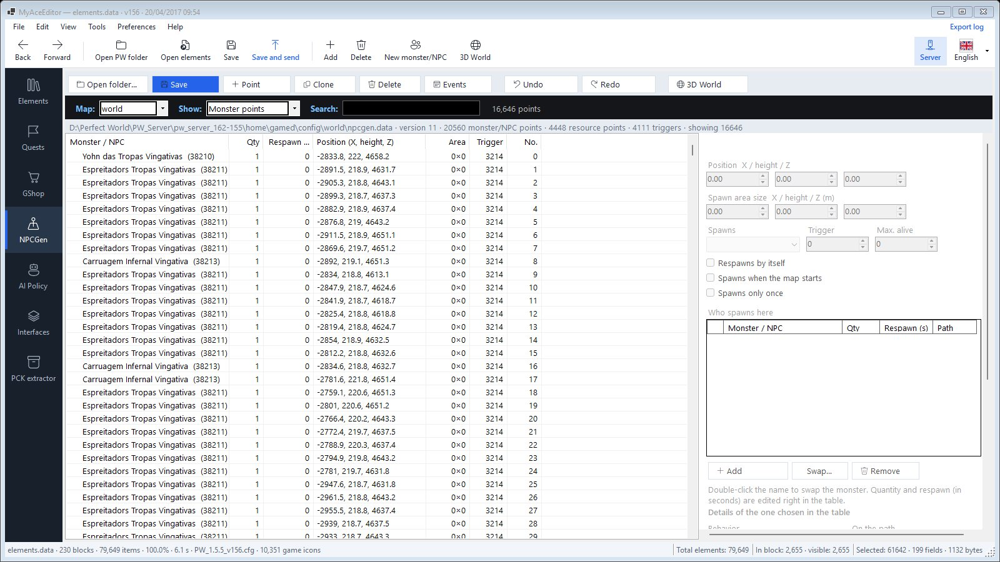 |
| Triggers, conditions and operations explained in plain words; monster speech translation | Where monsters, NPCs and resources spawn: quantity, respawn, radius, wizard for new ones |

---

## 🟪 Interface


| | |
|---|---|
| 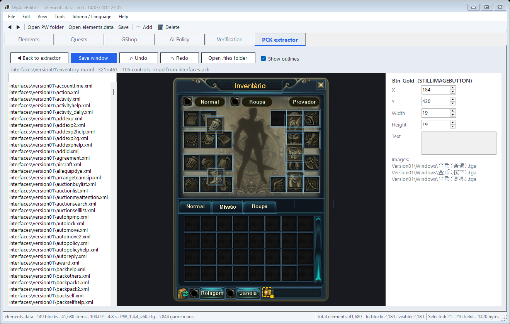 | 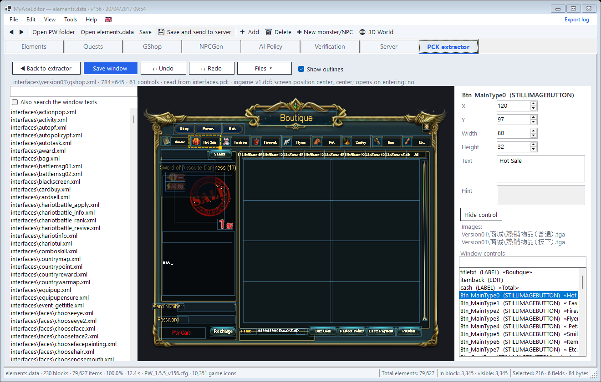 |
| **Interface editor** — game windows (`interfaces.pck`) drawn with the client's own fonts and textures: move, resize, edit text and hints, hide controls safely | **Every control listed**, with text search across all windows and which `.dcf` loads each window |
| 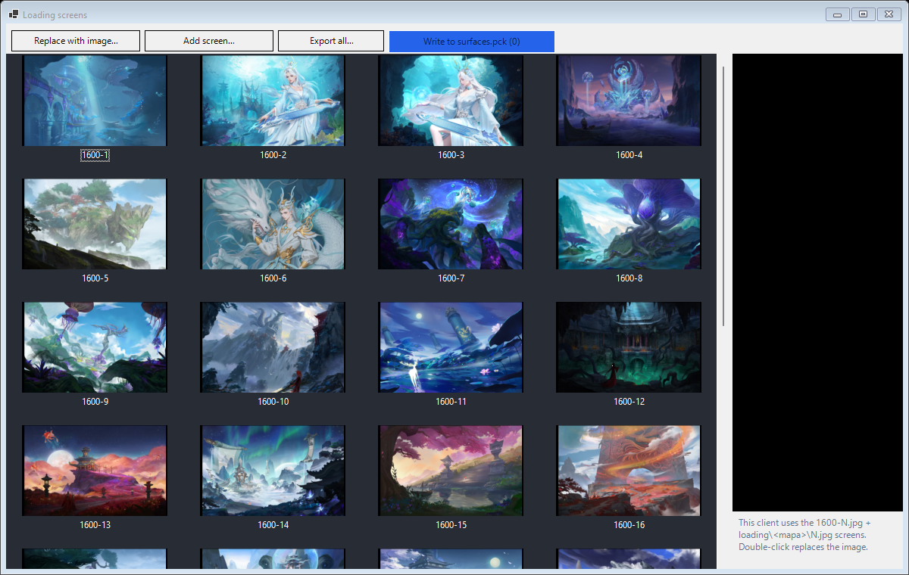 | 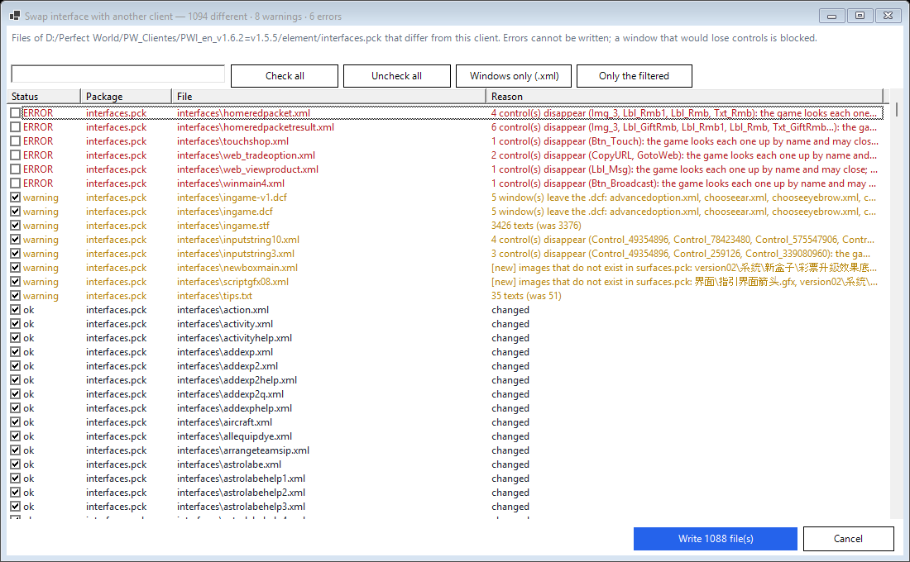 |
| **Loading screens and login background** — replace or add, any image format and size | **Swap or import** whole interfaces or single windows from another client; anything that would crash the game is refused |

Export a package to a folder, edit it with any tool and import it back: UTF-8 is converted to the UTF-16 the game
reads, broken XML is refused, and a window that loses a control the game looks for is refused.

---

## 🟧 Translation


- **Translate from another client** — quest texts, NPC speech, item texts, interface tables, window texts and hints,
  matched by ID or by window and control name. Only what your client has is touched; text with different
  `%d` / `%s` markers is skipped.
- **Translate with another `elements.data`**, with a review window before saving.
- The app itself speaks **English, Português, Русский and 简体中文**, and every screen is checked so no text is cut
  in any of them.

---

## 🟥 Server & GM


- **Verification** — the versions `elementclient.exe` and `gs` expect, the client × server pair, and interface
  windows that crash the client, with one-click fixes.
- **Local test server** (WSL) — install, start and *Save and send to server*.
- **Admin panel** — accounts, characters, who is online, broadcast, double EXP/drop, every map and instance.
- **GM panel** — a separate window beside the game for game masters.
- **Plugins** — event programs that run on the server, made from templates.
- **`.pck` extractor and writer** — native, no external tools.

---

## ⬜ Safety


- **Byte-identical round trip:** a format becomes editable only after reading and writing it back gives the same bytes.
- **Backups** of every file before it changes, in `%LOCALAPPDATA%\MyAceEditor\backups`. The first copy of each file and
  every copy still used by a backup item are never deleted. A restore can itself be undone ("Before restoring").
- **Atomic writes:** the new file is written beside the old one, checked, then swapped in. Saves that touch several
  files are all-or-nothing: if one fails, the others go back.
- **Game rules** from the server code are checked before saving; errors are explained in plain words.
- Still: work on a **copy of your game folder** until you get used to the tool.

---

## Install

Windows x64. Nothing else to install — .NET is inside the program.

1. Download `MyAceEditor-...-win-x64.zip` from **[Releases](https://github.com/ipasetto/MyAceEditor/releases)**.
2. Right-click the `.zip` → **Extract All…** (do not run it from inside the zip: it needs the `lang`, `PerfectWorld`
   and `Server` folders next to it).
3. Run **`MyAceEditor.exe`**. If *"Windows protected your PC"* appears: **More info → Run anyway** (the app is not
   signed yet; all the code is here).
4. **File → Open Perfect World folder…** and pick the folder that contains `element`. Next time it opens by itself.

**Local test server (optional):** in the **Server** tab pick a server package and click **Install / complete**.
If WSL is missing, run `wsl --install --no-distribution` as administrator and restart once.

## Build from source

Requires Windows and the .NET 10 SDK.

```bash
dotnet run
```

Distribution build (one compressed `MyAceEditor.exe` with .NET inside, in `dist\`):

```bash
dotnet publish -c Release -p:PublishProfile=Release-win-x64
```

Ship the whole `dist\` folder (`lang\`, `PerfectWorld\`, `Server\`, `glfw3.dll` are needed). The developer guide
starts at **[docs/dev/README.md](docs/dev/README.md)**.

## Contributing

Contributions are welcome — code, translations, tests on other game versions, bug reports with screenshots.
Start with the **[developer docs](docs/dev/README.md)** and the **[contribution guide](CONTRIBUTING.md)**, then pick
something from the **[issues](https://github.com/ipasetto/MyAceEditor/issues)**. The internal knowledge bases are
mostly in Portuguese; issues and pull requests in English are welcome.

## License

[GNU General Public License v3.0](LICENSE). You may use, study, modify and share MyAceEditor; distributed modified
versions must stay open source under the GPL-3.0.

## Credits

Format knowledge comes from studying community tools and documentation — sELedit, sTASKedit, sGSHOPedit,
AIPolicyEditor, sNPCedit, sMAPtool, uPCK, UIEdit / Perfect Interface Editor, the official AUIEditor, Rody's Angelica
Editor and the RaGEZONE, mmorpg-devs.ru and PWDevGroup communities (sources in [PW-KB §R](docs/kb/PW-KB.md)).
The code in this repository is original.

**Contributors:** LAOCHEN (RaGEZONE) — multi-version `elements.data` reader (170 layouts, v6–v623), MPPC decoder,
progress window, regression tests and the Simplified Chinese translation ([docs/zh-CN](docs/zh-CN)).

Perfect World is a trademark of Perfect World Co., Ltd. This project is not affiliated with it and does not distribute
game files.
