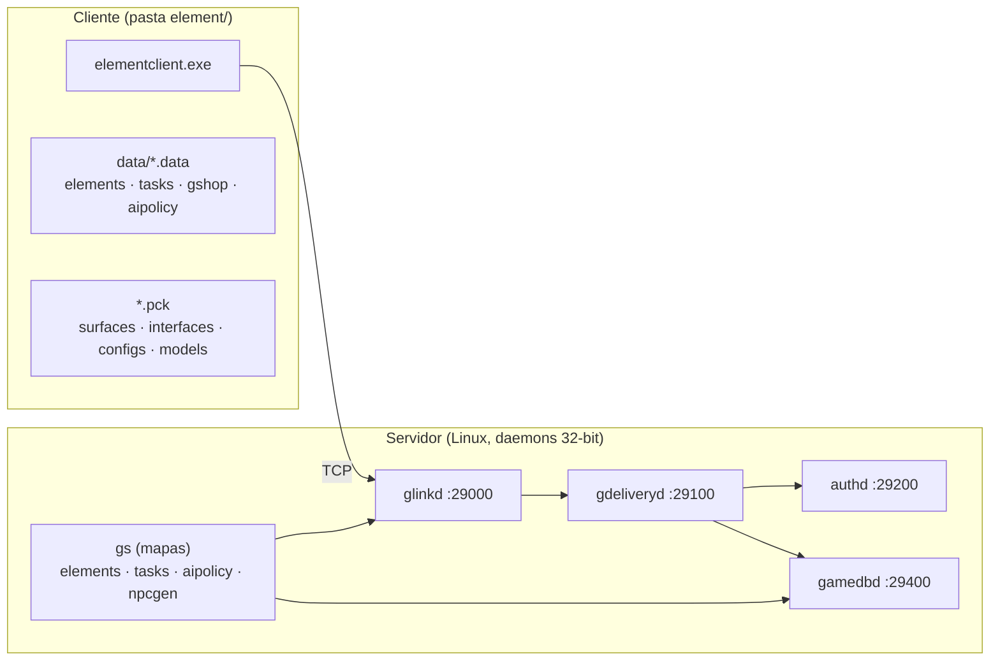
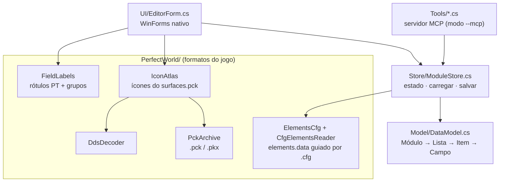
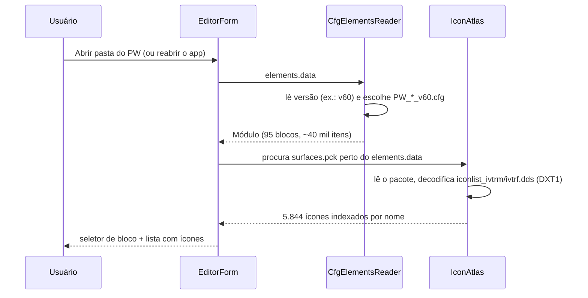

# Arquitetura do MyAceEditor

> Visão geral para quem chega ao projeto. Os detalhes técnicos completos (formatos binários,
> protocolo, IDs, dúvidas em aberto) ficam nas bases de conhecimento em [`docs/kb/`](kb/).

## 1. O que é

O MyAceEditor é uma **engine de edição do Perfect World** (motor Angelica): uma aplicação
desktop nativa em C#/WinForms que lê e edita os arquivos de dados do jogo, **do cliente e do
servidor**, sem depender de ferramentas externas.

A meta de longo prazo é tornar o jogo **100% editável** a partir de uma única janela:

| Fase | Capacidade | Estado |
|---|---|---|
| 1 | Ler e navegar `elements.data` (itens, equipamentos, NPCs, monstros…) | ✅ ~98,6% do arquivo |
| 1 | Ícones reais do jogo, lidos direto do `.pck` | ✅ 91,3% (o resto não existe no jogo) |
| 2 | Gravar `elements.data` (escrita byte-idêntica, backup automático) | ✅ |
| 2 | Vínculos entre itens (drops, receitas, quem usa) | ✅ |
| 2 | Quests (v93): campos, textos, diálogos, subquests | ✅ |
| 2 | GShop, AI Policy, NPCGen (spawns), quests completas | 🔜 formatos já documentados |
| 3 | Checar versão/edition do par cliente + servidor antes de publicar | ✅ |
| 3 | Gerar e publicar arquivos de servidor | 🔜 |
| 4 | Abrir janelas do próprio jogo dentro da engine (loja, inventário…) | 🔜 |
| 4 | Edição de skills | 🔜 |

## 2. Como o Perfect World funciona (resumo)



Pontos que guiam todo o desenho da engine:

- **Os dados existem em par.** `elements.data`, `tasks.data`, `gshop`/`gshopsev`, `aipolicy.data`
  aparecem no cliente **e** no servidor. Editar só um dos lados causa erro de versão ou
  comportamento estranho, por isso a engine trata sempre o **par** (PW-KB §S7).
- **Versão importa.** O cliente envia ao servidor uma `edition` calculada a partir da versão do
  `elements.data`, do `tasks.data` e dos timestamps da loja. Se não bater, a sessão cai
  (PW-KB §S17).
- **Os formatos não são autodescritivos.** Um `elements.data` é só uma sequência de listas de
  registros de tamanho fixo. Quem diz o que é cada campo é um arquivo `.cfg` por versão
  (PW-KB §S23).

## 3. Camadas do código



| Camada | Responsabilidade | Arquivos |
|---|---|---|
| **UI** | Janela, lista de itens, detalhes, menus, tooltip | `UI/EditorForm.cs` |
| **Agente (MCP)** | As mesmas operações expostas a um agente de IA | `Tools/*.cs`, modo `--mcp` |
| **Estado** | Módulo carregado, mudanças, salvar | `Store/`, `Changes/` |
| **Modelo** | Representação neutra: Módulo → Lista → Item → Campo | `Model/DataModel.cs` |
| **Formatos PW** | Ler e gravar cada formato do jogo | `PerfectWorld/` |

A regra é: **formatos não conhecem a UI** e **a UI não conhece bytes**. Cada formato novo
(GShop, AI Policy, NPCGen…) entra como um leitor/gravador em `PerfectWorld/` que produz o mesmo
modelo, e a UI ganha a aba correspondente.

## 4. Fluxo ao abrir a pasta do jogo



A última pasta aberta fica salva em `%AppData%\MyAceEditor`, e o app recarrega tudo sozinho ao
abrir.

## 5. Formatos implementados

### `elements.data`
- Cabeçalho: `int16` versão + `int16` assinatura (ex.: `0x3000003C` = versão 60) e timestamp.
- Depois, listas em ordem fixa: `uint32 count` + `count` registros de tamanho fixo.
- Os campos de cada lista vêm de um `.cfg` da comunidade (`PerfectWorld/cfg/`).
- Textos: `wstring:N` = UTF-16LE, `string:N` = **GBK** (caminhos de arquivo em chinês).
- Hierarquia de tipos: `id_major_type`/`id_sub_type` apontam para as listas `*_MAJOR_TYPE`/`*_SUB_TYPE`.

### `.pck` / `.pkx` (pacotes Angelica)
- `[cabeçalho 12B][arquivos][tabela][rodapé 280B]`; a tabela fica no fim, com offset protegido
  por XOR; cada entrada (caminho GBK, offset, tamanho) pode estar comprimida com zlib.
- `.pkx` é a continuação lógica de um `.pck` acima de 2 GB.

### Ícones
- `surfaces\iconset\iconlist_ivtrm.dds` (+ `ivtrf`): atlas DXT1 4096×2048 com ícones de 32×32.
- O `.txt` ao lado lista os nomes na ordem da grade; o campo `file_icon` do item aponta para um
  desses nomes.

Formatos já documentados e prontos para implementar (GShop, AI Policy, NPCGen, mapas do
servidor, XML de interface): ver PW-KB §S18–§S22.

## 6. Princípios de engenharia

1. **Round-trip antes de editar.** Um formato só ganha edição depois de provar que lê e grava o
   arquivo **byte a byte idêntico**.
2. **Backup e escrita atômica, sempre.** Nenhum editor de terceiros estudado faz isso direito
   (ENGINE-KB §E9).
3. **Editar o par.** Cliente e servidor são exportados juntos, com checagem de versão.
4. **Ícones e textos do próprio jogo.** Nada gerado artificialmente.
5. **Nativo e leve.** Sem web, sem dependências pesadas; abre e navega 40 mil itens na hora.

## 7. Base de conhecimento

| Arquivo | Conteúdo |
|---|---|
| [`kb/PW-KB.md`](kb/PW-KB.md) | O **jogo**: estrutura do cliente, daemons e portas do servidor, protocolo de login, formatos binários, banco de dados, versões, ferramentas |
| [`kb/ENGINE-KB.md`](kb/ENGINE-KB.md) | A **engine**: o que já está implementado, mapa capacidade → arquivo → seção da PW-KB, roadmap e dúvidas em aberto |
| [`../.claude/skills/pw-engine/SKILL.md`](../.claude/skills/pw-engine/SKILL.md) | Skill do Claude Code que ensina o agente a consultar e atualizar as KBs |

As KBs usam formato telegráfico e **etiquetas de confiança** em cada fato: `[C]` código-fonte
lido, `[A]` arquivo real, `[B]` binário, `[T]` testado no nosso código, `[I]` inferência,
`[?]` dúvida. Contradições resolvidas vão para a seção `§Z` e dúvidas novas para a `§Q`.

## 8. Rodar e compilar

```bash
dotnet run
```

```bash
dotnet publish -c Release -r win-x64 --self-contained -p:PublishSingleFile=true -o dist
```

Modos de linha de comando (diagnóstico):

| Modo | O que faz |
|---|---|
| `--inspect <elements.data>` | Relatório do parser |
| `--testcfg <cfg> <data>` | Valida um `.cfg` contra um `elements.data` |
| `--pck <arquivo.pck> [filtro]` | Lista o conteúdo de um pacote |
| `--icons <elements.data>` | Mede a cobertura de ícones e salva amostras |
| `--snapshot <saida.png>` | Abre o editor fora da tela e salva um print |
| `--mcp` | Servidor MCP por stdio para agentes de IA |
