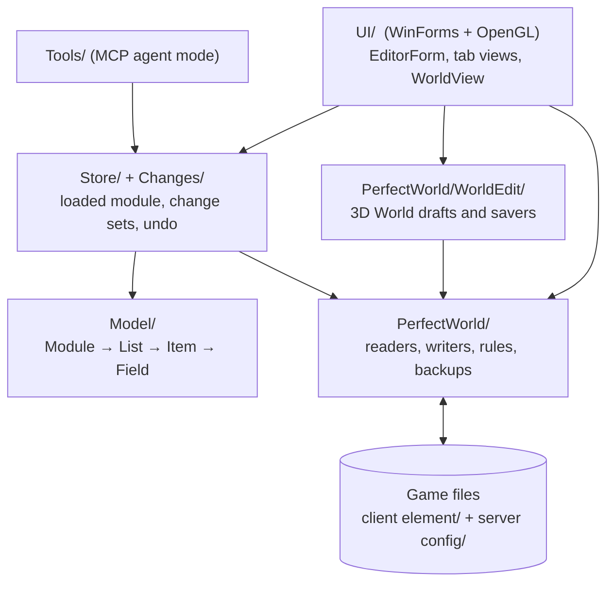
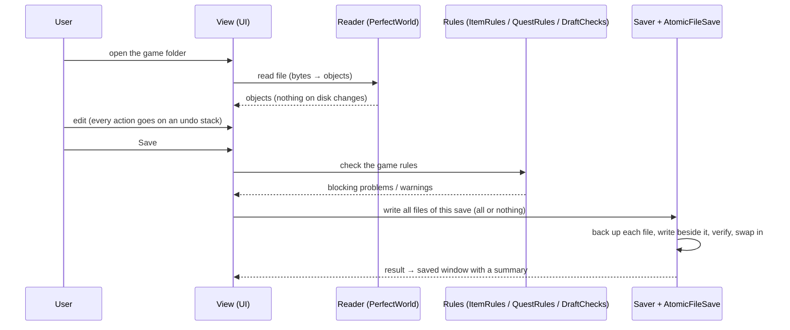

# 2. Architecture

## Layers

Two rules hold everywhere:

1. **Formats do not know the UI, and the UI does not know bytes.** A game format is a class in `PerfectWorld/` that
   reads bytes into objects and writes them back. A view in `UI/` shows and edits those objects.
2. **Client and server go together.** Many files exist on both sides (`elements.data`, `tasks.data`, `gshop` /
   `gshopsev`, `aipolicy`, the map files). Editing only one side breaks login or the game, so savers write the pair.

## The main window

`UI/EditorForm.cs` is the main window: a command ribbon on top, a navigation bar on the left and one page per area
(Elements, Quests, GShop, AI Policy, NPCGen, Interface, Server, PCK extractor, Plugins). Each page is its own control
(`NpcGenView`, `GShopView`, `AiPolicyView`, `InterfaceView`, `ServerView`, `PluginsView`…). The **3D World** is a
separate window, `UI/WorldView.cs`, opened from the toolbar; it receives the spawn points, NPC data and quest host
from `EditorForm` through delegates, so it does not depend on the main window's internals.

## The data flow: open → edit → check → save

- **Reading never changes a file.**
- **Writing only happens when the user clicks Save**, after the rules pass and the user confirms.
- **A format becomes editable only after a round trip is byte-identical**: read and write with no change must give the
  same bytes. Every reader has a command-line mode that proves it (chapter 7).

## Main classes by responsibility

| Responsibility | Classes |
|---|---|
| `elements.data` | `ElementsCfg`, `CfgElementsReader`, `ElementsReader`, `ElementsWriter`, `ElementsSchema`, `ElementsConverter` |
| Quests | `TasksFile`, `QuestBuilder`, `QuestRules` |
| Shop | `GShopFile` |
| AI | `AiPolicyFile`, `AiMeaning`, `AiTranslate` |
| Spawns | `NpcGenFile`, `NpcBuilder`, `PathFile` |
| Packages | `PckArchive` (read), `PckWriter` / `PckPatch` (write) |
| Images and icons | `DdsDecoder`, `IconAtlas`, `IconLoader` |
| Map scene | `WorldScene`, `EcwldFile`, `TerrainFile`, `BhtFile`, `PrecinctFile`, `DomainFile` |
| Game rules | `ItemRules`, `QuestRules`, `PluginRules`, `DraftChecks` (3D World) |
| Safety | `AtomicFileSave`, `BackupStore`, `BackupSets`, `AppLog` |
| Interface text | `UI/Loc.cs`, `AppLanguage`, `lang/*.json`, `TextureNameGlossary` |
| Server | `LocalServer`, `ServerAdmin`, `GameConsole`, `GmCommands`, `ServerNotice` |

`ServerNotice.Notify(file)` lights the *Save and send to server* button when a saved file still has to reach the
server.

## Threads

The UI thread owns every control. Heavy work (reading big files, building a save plan, writing a split `.pck`, loading
3D pieces) runs on a background task and comes back with `BeginInvoke`. The 3D World has its own loader
(`WorldLoader`) that hands results to the render loop a few milliseconds per frame, so the camera never waits for disk.
